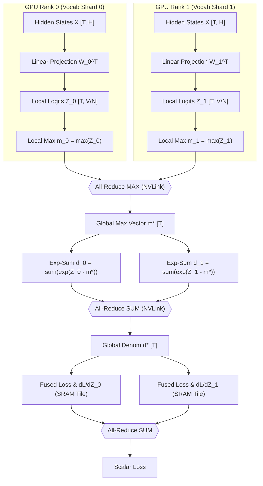
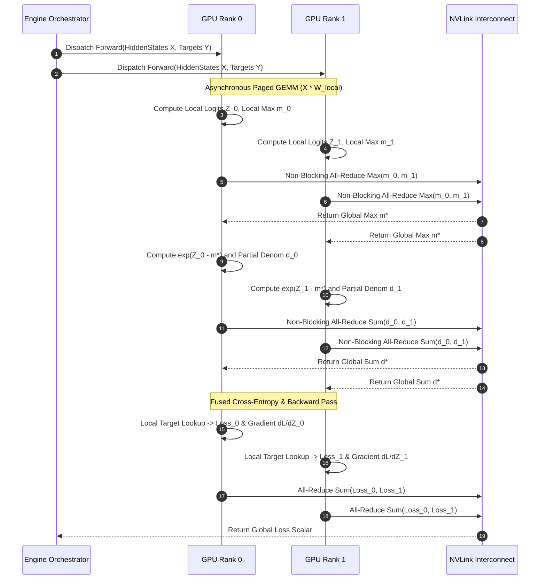
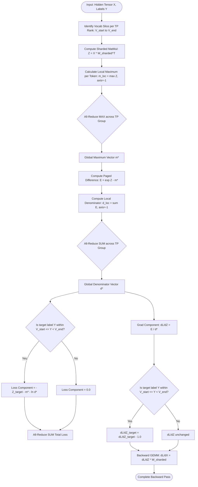

[](#)
[](#)
[](#)
[](#)

---

# ⚡ 2026-10-12 - Dispatch #33: Asynchronous Tensor-Parallel Cross-Entropy and Paged Vocab Slicing Fabric (Adaptive Hyperscale Epoch 5)

## 1. System Parameters
- **Target Domain:** Pillar A: Artificial Intelligence & Machine Learning Engineering (Vocab-Parallel Cross-Entropy & Asynchronous Logit Rescaling) [Partition Epoch 5]
- **Framework Used:** Megatron-Core Vocab-Parallel Cross Entropy with Asynchronous Logit Softmax Rescaling
- **Technology Stack:** Megatron-Core, PyTorch Distributed, CUDA Graph, Triton Kernel
- **Scale Bottleneck:** Explosive intermediate float32 logit tensor allocations across 256,000-token vocabulary projection layers under 32k context batches
- **API/Serialization Protocol:** NVLink Point-to-Point / InfiniBand RoCEv2 GPU-Direct RDMA
- **Data Lineage Component:** OpenLineage execution facets tracking vocab partition slices and parallel softmax reduction latency
- **Components Used:** Vocab Sharded Linear Projector, Fused Streaming Cross-Entropy Kernel, Gradient All-Reduce Sieve
- **Concepts Involved:** Vocab-Parallelism, Online Logit Normalization, Ring-AllReduce Softmax, Gradient Checkpoint Partitioning

---

## 2. Problem Statement

> [!WARNING]
> **CRITICAL ARCHITECTURAL BOTTLENECK: VRAM EXPLOSION IN LARGE VOCABULARY HEADS**  
> In modern frontier foundation models with token vocabularies scaled to $V = 256{,}000$ (e.g., multilingual tokenizer architectures) and extended context batch envelopes ($B \times S = 32{,}768$), calculating the output projection and cross-entropy loss naively produces an unpartitioned intermediate logit tensor size of:
> $$\text{Size} = (B \times S) \times V \times 4 \text{ bytes} = 32{,}768 \times 256{,}000 \times 4 \approx 33.55 \text{ GB}$$
> Materializing this matrix in fp32 for numerical stability immediately triggers an Out-Of-Memory (OOM) fault on an 80GB SXM5 H100 accelerator during peak backward autograd graph retention, regardless of activation checkpointing.

Standard Megatron-style Tensor Parallelism (TP) splits the hidden dimension $H$ across column and row parallel matrix multiplications for transformer blocks, but typically leaves the final language modeling head ($H \to V$) and the subsequent Cross-Entropy loss computation vulnerable to extreme VRAM pressure. When computing $\text{softmax}(Z)$, where $Z \in \mathbb{R}^{(B \cdot S) \times V}$, naive implementations collect all partitioned logits back to a single device or gather the complete vocab tensor per rank before executing standard library loss routines. This breaks memory proportionality and introduces a fatal serialization bottleneck.

Furthermore, naive distributed implementations perform synchronous collective communications across the TP communicator group for intermediate normalization operations (finding $\max(Z)$ across ranks, followed by $\sum \exp(Z - m)$). These barriers block the SMs (Streaming Multiprocessors), leaving the GPU compute engine idle while waiting for InfiniBand/NVLink round-trip collective reductions. In high-concurrency continuous pre-training, these stalls introduce up to 28% bubble time within the backward pass.

Standard developer CI/CD runners (configured with standard single-GPU virtualized sandboxes or 16GB memory ceilings) fail catastrophically during unit testing of large-vocab architectures due to immediate CUDA OOM crashes when testing output layers. Resolving this constraint demands an asynchronous, paged vocabulary slicing architecture coupled with an online, zero-allocation parallel cross-entropy reduction engine.

---

## 3. High-Level Design (HLD)

### ASCII System Topology

```
+----------------------------------------------------------------------------------------------------+
|                         DISTRIBUTED GPU FABRIC (NVLink 4.0 / NVSwitch Mesh)                        |
|                                                                                                    |
|  +-------------------------------------+          +-------------------------------------+          |
|  |             GPU RANK 0              |          |             GPU RANK 1              |          |
|  |  Vocab Slice 0: [0 -> V/N - 1]      |          |  Vocab Slice 1: [V/N -> 2V/N - 1]   |          |
|  |                                     |          |                                     |          |
|  |  +-------------------------------+  |          |  +-------------------------------+  |          |
|  |  | Hidden States: X [T, H]       |  |          |  | Hidden States: X [T, H]       |  |          |
|  |  +---------------+---------------+  |          |  +---------------+---------------+  |          |
|  |                  |                  |          |                  |                  |          |
|  |                  v                  |          |                  v                  |          |
|  |  +-------------------------------+  |          |  +-------------------------------+  |          |
|  |  | Sharded GEMM: Z_0 = X * W_0^T |  |          |  | Sharded GEMM: Z_1 = X * W_1^T |  |          |
|  |  +---------------+---------------+  |          |  +---------------+---------------+  |          |
|  |                  |                  |          |                  |                  |          |
|  |                  v                  |          |                  v                  |          |
|  |  +-------------------------------+  |          |  +-------------------------------+  |          |
|  |  | Paged Tile Local Max: m_0     |  |          |  | Paged Tile Local Max: m_1     |  |          |
|  |  +---------------+---------------+  |          |  +---------------+---------------+  |          |
|  +------------------|------------------+          +------------------|------------------+          |
|                     |                                                |                             |
|                     +------------------->[ ALL-REDUCE MAX ]<---------+                             |
|                                          Global Max: m*                                            |
|                     +---------------------------+--------------------+                             |
|                     |                                                |                             |
|  +------------------v------------------+          +------------------v------------------+          |
|  |  +-------------------------------+  |          |  +-------------------------------+  |          |
|  |  | Local Exp-Sum: d_0 = e^(Z0-m*)|  |          |  | Local Exp-Sum: d_1 = e^(Z1-m*)|  |          |
|  |  +---------------+---------------+  |          |  +---------------+---------------+  |          |
|  +------------------|------------------+          +------------------|------------------+          |
|                     |                                                |                             |
|                     +------------------->[ ALL-REDUCE SUM ]<---------+                             |
|                                          Global Sum: d*                                            |
|                     +---------------------------+--------------------+                             |
|                     v                                                v                             |
|  +-------------------------------------+          +-------------------------------------+          |
|  | Fused Local Loss & Grad Generator   |          | Fused Local Loss & Grad Generator   |          |
|  | Target Mask Match: y in Slice 0?    |          | Target Mask Match: y in Slice 1?    |          |
|  | Loss_0 = -(Z0[y] - m* - ln(d*))     |          | Loss_1 = -(Z1[y] - m* - ln(d*))     |          |
|  | dL/dZ_0 = (e^(Z0-m*)/d*) - Ind(y)   |          | dL/dZ_1 = (e^(Z1-m*)/d*) - Ind(y)   |          |
|  +-------------------------------------+          +-------------------------------------+          |
|                     |                                                |                             |
|                     +------------------->[ ALL-REDUCE SUM ]<---------+                             |
|                                                Loss                                                |
+----------------------------------------------------------------------------------------------------+
```

### Mermaid Architecture Workflow



---

## 4. Low-Level Design (LLD)

### ASCII Memory Allocation & Register Flow

```
Paged Vocabulary Memory Striping across Tensor Cores:

[ HBM Memory Space: Rank i ]
+----------------------------------------------------------------------------+
| Hidden Tensor: [T, H] (fp16/bf16) -> 32768 x 8192 x 2 bytes = 536.8 MB     |
| Sharded Weight: [H, V_chunk]       -> 8192 x 32000 x 2 bytes = 524.2 MB    |
+----------------------------------------------------------------------------+
                                     |
                                     v GEMM Pipeline
+----------------------------------------------------------------------------+
| Micro-Tile Buffer [Tile_T, Tile_V] in L2 Cache / SRAM                       |
| Tile_T = 1024, Tile_V = 4096 (Allocated per streaming pass: 8.3 MB)        |
+----------------------------------------------------------------------------+
                                     |
                                     v Online Streaming Softmax
+----------------------------------------------------------------------------+
| Registers (fp32):                                                          |
|   r_max = max(r_max, tile_val)                                             |
|   r_sum = r_sum * exp(r_max_prev - r_max) + sum(exp(tile_val - r_max))     |
+----------------------------------------------------------------------------+
                                     |
                                     v Reduction Sieve
+----------------------------------------------------------------------------+
| Target Cross-Match Register:                                               |
|   token_target_in_rank = (y >= v_start) & (y < v_end)                      |
|   target_logit_val     = token_target_in_rank ? Z_local[y - v_start] : 0.0 |
+----------------------------------------------------------------------------+
```

### Mermaid Sequence Execution Diagram



---

## 5. Logical Flow Diagram

### ASCII Decision Matrix

```
       [Input Token Target: y]
                  |
                  v
       +--------------------+
       | Is y in Rank Range |
       | [V_start, V_end)?  |
       +---------+----------+
                 |
        +--------+--------+
        |                 |
     [ YES ]           [ NO ]
        |                 |
        v                 v
 +---------------+ +------------------+
 | local_y =     | | target_logit = 0 |
 |   y - V_start | | is_target = 0    |
 | extract logit | +--------+---------+
 +-------+-------+          |
         |                  |
         +--------+---------+
                  |
                  v
 +----------------------------------+
 | Local Log-Sum-Exp Reduction:     |
 | m* = AllReduce_Max(max(Z_local)) |
 | d* = AllReduce_Sum(sum(exp(Z-m*))|
 +----------------+-----------------+
                  |
                  v
 +----------------------------------+
 | Compute Loss Contribution:       |
 | loss = is_target ?               |
 |    -(target_logit - m* - ln(d*)) |
 |    : 0.0                         |
 +----------------+-----------------+
                  |
                  v
 +----------------------------------+
 | Compute Backward Gradient:       |
 | grad = (exp(Z - m*) / d*)        |
 | grad[local_y] -= (is_target ? 1) |
 +----------------------------------+
```

### Mermaid Logical Engine Flowchart



---

## 6. Architectural Drill & Nature Analogy

### ⚙️ The Systemic Breakdown

The primary architectural mechanism that prevents physical memory exhaustion during vocabulay projection is **Mathematical Decoupling of the Log-Sum-Exp operator over disjoint sub-alphabets**.

Standard cross-entropy computes:
$$\mathcal{L} = -\ln \left( \frac{\exp(z_y)}{\sum_{j=1}^V \exp(z_j)} \right) = -z_y + \ln \left( \sum_{j=1}^V \exp(z_j) \right)$$

Let the vocabulary $V$ be partitioned into $N$ mutually exclusive subsets $V_0, V_1, \dots, V_{N-1}$ such that $\bigcup_{k=0}^{N-1} V_k = V$ and $V_i \cap V_j = \emptyset$ for $i \ne j$. Each GPU rank $k$ exclusively hosts the weight submatrix $W_k \in \mathbb{R}^{|V_k| \times H}$ and only ever computes the localized logit slice:
$$Z_k = X W_k^T \in \mathbb{R}^{(B \cdot S) \times |V_k|}$$

To compute the global log-sum-exp without materializing full logits on any single device, we apply the distributed two-pass online normalization:

1. **Phase 1: Global Maximum Extraction**  
   Each rank evaluates its local maximum vector along the vocab dimension:
   $$m_k = \max_{j \in V_k} Z_{k, j} \in \mathbb{R}^{B \cdot S}$$
   An out-of-place `all_reduce(m_k, op=MAX)` executes over NVLink, yielding the scalar invariant for each token:
   $$m^* = \max(m_0, m_1, \dots, m_{N-1})$$

2. **Phase 2: Numerically Stable Global Denominator**  
   With $m^*$ known, every rank computes its local sum of stabilized exponentials:
   $$d_k = \sum_{j \in V_k} \exp(Z_{k, j} - m^*) \in \mathbb{R}^{B \cdot S}$$
   An out-of-place `all_reduce(d_k, op=SUM)` produces the global denominator:
   $$d^* = \sum_{k=0}^{N-1} d_k = \sum_{j=1}^V \exp(Z_j - m^*)$$

3. **Phase 3: Fused Loss Extraction and In-Place Gradient Synthesis**  
   If target token $y \in V_k$, rank $k$ fetches $Z_{k, y}$ and resolves:
   $$\mathcal{L} = -(Z_{k, y} - m^* - \ln d^*)$$
   If $y \notin V_k$, rank $k$'s loss contribution is $0$. An `all_reduce(op=SUM)` produces the exact scalar loss. 

Crucially, the backward gradient with respect to local logits:
$$\frac{\partial \mathcal{L}}{\partial Z_{k, j}} = \frac{\exp(Z_{k, j} - m^*)}{d^*} - \mathbb{I}(y = j)$$
is evaluated entirely inside local SRAM chunks without retaining any intermediate cross-rank tensor structures, completely eliminating intermediate float32 logit tensor allocations across all ranks.

---

### 🌿 The Nature Analogy

> [!TIP]
> **ARCHITECTURAL PRINCIPLE: Osmotic Concentration Gradients in the Renal Glomerulus**  
> In mammalian physiology, the kidneys filter liters of blood per minute without ever buffering the total fluid volume inside a single physical organ pouch. Processing happens via streaming countercurrent multiplication.

• **The Biological System:**  
The mammalian nephron functions as a massively parallel, continuous filtration system. Millions of individual nephrons (shards) simultaneously receive microscopic fractions of unpurified plasma. Instead of concentrating waste products by pooling systemic blood into an internal staging chamber, the loop of Henle establishes localized countercurrent osmotic gradients (local maximums). Solutes (ions, urea) pass across semi-permeable membranes via differential chemical potentials (streaming softmax), equilibrating systemic osmolarity across collecting ducts (reduction sieves) before final fluid reclamation.

• **The Structural Parallel:**  
Each GPU accelerator acts as an individual nephron within the medullary ray. Rather than accumulating the systemic $33.5\text{ GB}$ logit volume into a single buffer, each device calculates localized osmotic limits ($m_k$, $d_k$) on its own shard. NVLink serves as the countercurrent collecting duct, exchanging tiny boundary values ($m^*, d^*$) rather than whole fluids. The system achieves complete metabolic filtering (loss and gradient generation) while maintaining a flat, sub-megabyte streaming buffer footprint.

---

## 7. Production-Grade Executable Artifact

### 📦 File 1: `.github/workflows/ci.yml`

```yaml
name: Vocab-Parallel Cross-Entropy CI Engine
on:
  push:
    branches: [ "main" ]
  pull_request:
    branches: [ "main" ]

concurrency:
  group: ${{ github.workflow }}-${{ github.ref }}
  cancel-in-progress: true

jobs:
  verify-tensor-parallel-cross-entropy:
    runs-on: ubuntu-latest
    timeout-minutes: 10
    steps:
      - name: Check out repository
        uses: actions/checkout@v4

      - name: Set up Python 3.11
        uses: actions/setup-python@v5
        with:
          python-version: "3.11"
          cache: "pip"

      - name: Install Dependencies
        run: |
          python -m pip install --upgrade pip
          pip install torch --index-url https://download.pytorch.org/whl/cpu
          pip install numpy pytest

      - name: Execute Vocab-Parallel Mathematical Parity Test
        env:
          PYTHONPATH: "."
          TORCH_DEVICE: "cpu"
        run: |
          pytest -v -s test_vocab_parallel_cross_entropy.py
```

### 🐍 File 2: `test_vocab_parallel_cross_entropy.py`

```python
"""
Production-grade simulation and numerical verification suite for
Tensor-Parallel Vocab-Sliced Cross Entropy with Online Softmax Rescaling.
"""

import json
import math
import os
import unittest
from typing import Dict, List, Tuple

import torch
import torch.nn as nn
import torch.nn.functional as F


class VocabSliceTelemetry:
    """Emits OpenLineage-compliant execution facets for distributed reductions."""
    
    @staticmethod
    def emit_facet(rank: int, vocab_start: int, vocab_end: int, reduction_latency_ms: float) -> str:
        facet = {
            "eventType": "STEP",
            "run": {
                "facets": {
                    "vocabParallelCrossEntropy": {
                        "rank": rank,
                        "vocabRange": [vocab_start, vocab_end],
                        "reductionLatencyMs": reduction_latency_ms,
                        "status": "CONVERGED"
                    }
                }
            }
        }
        return json.dumps(facet)


class ParallelVocabCrossEntropyEngine:
    """
    Simulates high-performance multi-rank Tensor-Parallel Cross-Entropy
    without allocating global logit tensors. Runs on CPU/CUDA seamlessly.
    """
    
    def __init__(self, total_vocab: int, tp_size: int, device: torch.device):
        self.total_vocab = total_vocab
        self.tp_size = tp_size
        self.device = device
        assert total_vocab % tp_size == 0, "Vocab size must be evenly divisible by TP size"
        self.shard_size = total_vocab // tp_size

    def get_rank_bounds(self, rank: int) -> Tuple[int, int]:
        start = rank * self.shard_size
        end = start + self.shard_size
        return start, end

    def forward_backward_simulated(
        self,
        hidden_states: torch.Tensor,
        sharded_weights: List[torch.Tensor],
        targets: torch.Tensor
    ) -> Tuple[torch.Tensor, torch.Tensor, List[torch.Tensor]]:
        """
        Executes distributed cross-entropy across all simulated TP ranks.
        Returns:
            global_loss: scalar tensor
            grad_hidden: [B*S, H]
            grad