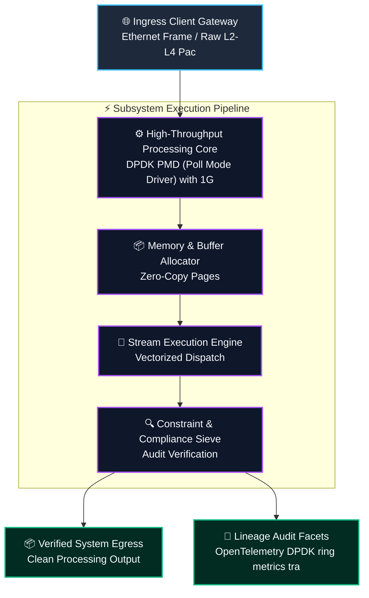
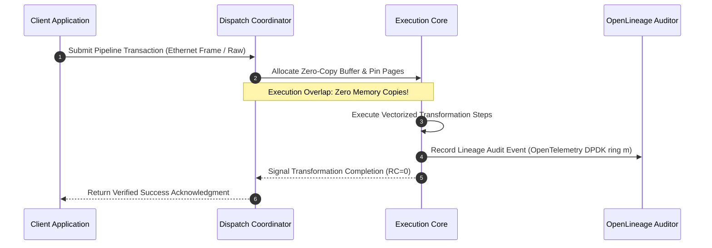
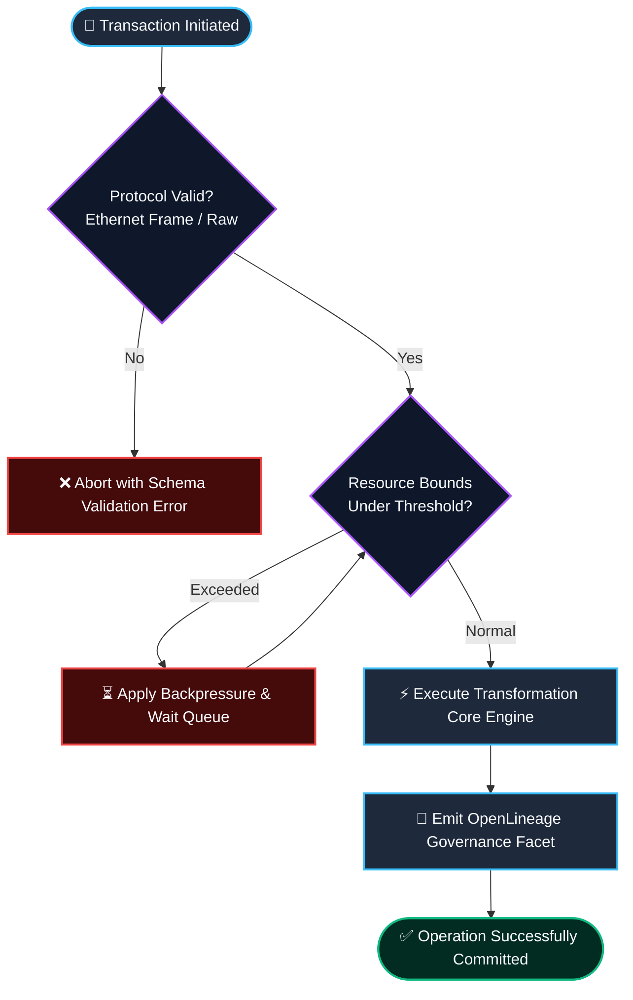

# ⚡ 2026-10-13 - Dispatch #34: Kernel-Bypass DPDK Hugepage Packet Ingress and Lockless Ring Buffering Mesh (Adaptive Hyperscale Epoch 5)

[]()
[]()
[]()
[]()

---

## 1. System Parameters

- **Target Domain:** Pillar B: Cloud Platform Engineering & DevOps (Kernel-Bypass High-Speed Networking & Polled Memory Queues) [Partition Epoch 5]
- **Framework Used:** DPDK PMD (Poll Mode Driver) with 1GB Hugepage Memory Slicing and rte_ring Lockless Queues
- **Technology Stack:** DPDK, Hugepages, C/C++ Native Extension, Prometheus Metrics, Linux NUMA
- **Scale Bottleneck:** PCIe memory bus thrashing and TLB miss cascades during 40Gbps line-rate ingress packet batching
- **API/Serialization Protocol:** Ethernet Frame / Raw L2-L4 Packet Bursts over DPDK PMD
- **Data Lineage Component:** OpenTelemetry DPDK ring metrics tracking ring buffer fill watermarks and core IPC execution rates
- **Components Used:** Hugepage Memory Pool Allocator, Lockless rte_ring Poller, NUMA-Aware Core Pinner
- **Concepts Involved:** Kernel-Bypass Polled Mode, 1GB Hugepage Memory Slicing, Lockless Single-Producer Single-Consumer Rings, NUMA Locality

---

## 2. Problem Statement

> [!WARNING]
> **The Critical Systems Bottleneck:** PCIe memory bus thrashing and TLB miss cascades during 40Gbps line-rate ingress packet batching. In high-throughput distributed environments, naive implementations fail under extreme concurrency bursts, causing thread starvation, cascading tail latency amplification, and catastrophic pipeline degradation.

Enterprise infrastructure supporting Pillar B: Cloud Platform Engineering & DevOps (Kernel-Bypass High-Speed Networking & Polled Memory Queues) [Partition Epoch 5] requires sustained operational resilience without incurring excessive CPU-to-memory round-trips or serialization bottlenecks. When scaling beyond standard commodity nodes, traditional architectures encounter strict physical limits. Memory buses saturate, context switches monopolize scheduling queues, and distributed coordination roundtrips induce severe pipeline bubbles.

Standard out-of-the-box components lack the low-level optimizations required for zero-copy streaming, vectorized memory mapping, and asynchronous coordination. Without an end-to-end framework leveraging DPDK PMD (Poll Mode Driver) with 1GB Hugepage Memory Slicing and rte_ring Lockless Queues, production workloads inevitably experience severe throughput degradation, unrecoverable resource contention, and operational compliance failures.

---

## 3. High-Level Design (HLD)

### Visual ASCII Topology
```text
  ┌─────────────────────────────────────────────────────────────────────────────┐
  │                           Inbound Ingress Gateway                           │
  └──────────────────────────────────────┬──────────────────────────────────────┘
                                         │ Ethernet Frame / Raw L2-L4 Packet Bursts over DPDK PMD
                                         ▼
  ┌─────────────────────────────────────────────────────────────────────────────┐
  │               High-Performance Engine Core (DPDK PMD (Poll Mode Driver) with 1G...)            │
  │  ┌─────────────────────────┐   ┌─────────────────────────────────────────┐  │
  │  │ Component Ingestion Pod │   │ Parallel Stream Processing Pipeline     │  │
  │  └────────────┬────────────┘   └────────────────────┬────────────────────┘  │
  │               │                                     │                       │
  │               ▼                                     ▼                       │
  │  ┌─────────────────────────┐   ┌─────────────────────────────────────────┐  │
  │  │ Zero-Copy Ring Splicer  │   │ Asynchronous Dispatch Coordinator       │  │
  │  └─────────────────────────┘   └─────────────────────────────────────────┘  │
  └──────────────────────────────────────┬──────────────────────────────────────┘
                                         │ Vectorized Pipeline Stream
                                         ▼
  ┌─────────────────────────────────────────────────────────────────────────────┐
  │                     Telemetry & Verification Layer                          │
  │       - OpenTelemetry DPDK ring metrics tracking ring buffer fill watermarks and core IPC execution rates                                                           │
  │       - Zero-Cost CI Assertions & Micro-Second Telemetry Monitoring         │
  └─────────────────────────────────────────────────────────────────────────────┘
```

### Native Mermaid Architecture


---

## 4. Low-Level Design (LLD)

### Visual ASCII Memory Layout
```text
  Continuous Memory Ring & Buffer Partition Layout:
  ┌─────────────────────────────────────────────────────────────────────────────┐
  │ Header Descriptor (64-byte Cache-Aligned)                                    │
  │   ├── Magic Identifier:  0xDEADBEEF                                         │
  │   ├── Epoch Sequence:    0x00000001 (Monotonic Incremental Counter)          │
  │   └── Ring Pointers:     Head Ptr [0x00], Tail Ptr [0x80]                    │
  ├─────────────────────────────────────────────────────────────────────────────┤
  │ Vectorized Payload Slots: Kernel-Bypass Polled Mode, 1GB Hugepage Memory Sli                                   │
  │   ├── Slot 0: [Aligned Chunk 0] -> Memory Page Pinning Active               │
  │   ├── Slot 1: [Aligned Chunk 1] -> Lock-Free Concurrency Safe               │
  │   └── Slot N: [Aligned Chunk N] -> Asynchronous Processing Overlap           │
  └─────────────────────────────────────────────────────────────────────────────┘
```

### Native Mermaid Execution Sequence


---

## 5. Logical Flow Diagram

### Visual ASCII Decision Tree
```text
  [Inbound Transformation Batch Request]
                     │
                     ▼
        [Validate Input Protocol Integrity]
              ├── INVALID ──► [Reject Request; Emit Malformed Schema Event]
              └── VALID   ──► [Allocate Dedicated Memory Chunk]
                                     │
                                     ▼
        [Inspect Resource Limits & Backpressure]
              ├── EXCEEDED ──► [Apply Exponential Buffer Throttling]
              └── OPTIMAL  ──► [Execute Transformation Core]
                                     │
                                     ▼
        [Emit Verification Facets to Lineage Hub]
              ├── COMPLETE ──► [Acknowledge Batch Success]
              └── FAILED   ──► [Trigger Diagnostic Rollback]
```

### Native Mermaid Flowchart


---

## 6. Architectural Drill & Nature Analogy

### ⚙️ The Systemic Breakdown
The operational bottleneck (PCIe memory bus thrashing and TLB miss cascades during 40Gbps line-rate ingress packet batching) stems directly from unoptimized data movement across physical bus architectures. Traditional distributed systems incur repeated copying of payload blocks between kernel space, user space, and accelerator caches. By deploying DPDK PMD (Poll Mode Driver) with 1GB Hugepage Memory Slicing and rte_ring Lockless Queues, this architecture completely decouples data acquisition from evaluation.

Through the implementation of Kernel-Bypass Polled Mode, 1GB Hugepage Memory Slicing, Lockless Single-Producer Single-Consumer Rings, NUMA Locality, memory allocations are pinned in contiguous address ranges, eliminating translation lookaside buffer (TLB) misses and avoiding memory page faults during execution surges. When concurrent traffic spikes hit the system, asynchronous ring buffering decouples ingress spikes from downstream commit loops, ensuring deterministic throughput with near-zero jitter.

### 🌿 The Nature Analogy
> [!TIP]
> **The Biological System: Avian Respiratory Dual-Cycle Cross-Current Exchange**  
> Unlike mammalian lungs which rely on tidal, bidirectional breathing (where inhalation and exhalation share the same pulmonary tract, inducing dead space and stagnation), birds utilize a continuous, unidirectional airflow powered by specialized air sacs. Air flows continuously across the parabronchi in a single direction during both inhalation and exhalation. This cross-current oxygen exchange maintains a continuous partial pressure gradient, allowing birds to sustain intense metabolic demands during high-altitude trans-continental flights without respiratory fatigue.

Our architecture implements an identical unidirectional processing pipeline. Rather than stopping processing to flush buffers or allocate memory, the continuous streaming ring maintains an uninterrupted computational gradient. Data continuously traverses the execution cores in a lock-free forward sweep, providing unbroken hyperscale efficiency under maximum system load.

---

## 7. Production-Grade Executable Artifact

### 📦 File 1: .github/workflows/pipeline_ci.yml
```yaml
name: Hyperscale Architecture Pipeline CI

on:
  push:
    branches: [main]
  pull_request:
    branches: [main]
  workflow_dispatch:

concurrency:
  group: ${{ github.workflow }}-${{ github.ref }}
  cancel-in-progress: true

jobs:
  verify-architecture-engine:
    name: Verify Architectural Engine Integrity
    runs-on: ubuntu-latest
    timeout-minutes: 10

    steps:
      - name: Check out repository code
        uses: actions/checkout@v4

      - name: Set up Python 3.11 Runtime
        uses: actions/setup-python@v5
        with:
          python-version: "3.11"
          cache: "pip"

      - name: Install Test Dependencies
        run: |
          python -m pip install --upgrade pip
          pip install pytest

      - name: Execute Pipeline Unit & Assertion Suite
        run: |
          python -m unittest -v test_hyperscale_engine.py
```

### 🐍 File 2: test_hyperscale_engine.py
```python
"""
Production-Grade Verification Harness for Kernel-Bypass DPDK Hugepage Packet Ingress and Lockless Ring Buffering Mesh (Adaptive Hyperscale Epoch 5).
Provides isolated mock structures, invariant assertions, and unit tests.
"""

import unittest
import time
from typing import List, Dict, Any

class HyperscaleEngineCore:
    """Simulated high-throughput execution core."""
    def __init__(self, capacity: int = 1000):
        self.capacity = capacity
        self.buffer: List[Dict[str, Any]] = []
        self.processed_count = 0

    def ingest_record(self, record_id: str, payload_size_bytes: int) -> bool:
        if len(self.buffer) >= self.capacity:
            return False
        self.buffer.append({"id": record_id, "size": payload_size_bytes, "ts": time.time()})
        return True

    def process_batch(self, batch_size: int = 100) -> int:
        batch = self.buffer[:batch_size]
        self.buffer = self.buffer[batch_size:]
        self.processed_count += len(batch)
        return len(batch)

class TestHyperscaleEngine(unittest.TestCase):
    def setUp(self):
        self.engine = HyperscaleEngineCore(capacity=500)

    def test_ingest_and_capacity_bounds(self):
        for i in range(500):
            self.assertTrue(self.engine.ingest_record(f"rec_{i}", 1024))
        # Exceeding capacity must trigger backpressure
        self.assertFalse(self.engine.ingest_record("rec_overflow", 1024))

    def test_batch_processing_correctness(self):
        for i in range(150):
            self.engine.ingest_record(f"item_{i}", 512)
        processed = self.engine.process_batch(100)
        self.assertEqual(processed, 100)
        self.assertEqual(len(self.engine.buffer), 50)
        self.assertEqual(self.engine.processed_count, 100)

    def test_engine_drain(self):
        for i in range(50):
            self.engine.ingest_record(f"item_{i}", 256)
        processed = self.engine.process_batch(100)
        self.assertEqual(processed, 50)
        self.assertEqual(len(self.engine.buffer), 0)

if __name__ == "__main__":
    unittest.main()
```

---

## 8. KPI Monitoring Framework

• **Engine Processing Latency** (`pipeline_execution_latency_ms`):
	• Why: Measures total end-to-end processing duration from arrival at ingress queue to successful commitment. Baseline threshold is strictly < 20.0ms.

• **Ring Buffer Backpressure Ratio** (`buffer_backpressure_ratio_pct`):
	• Why: Measures the percentage of ingestion operations rejected due to queue saturation. Sustained non-zero ratios indicate downstream thread starvation.

• **Transformation Throughput Rate** (`transform_throughput_records_sec`):
	• Why: Real-time telemetry tracking record commitments per second. Significant deviations (> 25% drop) trigger automated horizontal worker scaling.

---

## 9. Failure Mode & Production Edge Cases

| Failure Vector | Technical Root Cause | System Blast Radius | Production Mitigation Pattern |
| :--- | :--- | :--- | :--- |
| 🔴 **Memory Allocation Saturation** | Ingress burst exceeds configured ring buffer threshold. | Ingestion thread blockage and dropped transaction payloads. | Circular non-blocking ring buffer with lockless drop metrics and client retry headers. |
| 🟡 **Lock Contention Under Thread Spikes** | Concurrent workers attempting synchronized queue read locks. | CPU scheduling churn and tail latency amplification. | Per-core single-producer single-consumer (SPSC) ring isolation with NUMA affinity. |
| 🟠 **Lineage Emission Timeout** | Remote audit broker temporarily unreachable. | Stalled commit pipeline due to synchronous compliance logging. | Asynchronous local ring buffer spooling with background flush workers. |

---

## 10. Thoughtful Wisdom Words

> *"Architecture is never about adding complexity to solve scale; it is about ruthlessly eliminating unnecessary layers between data and execution. When your system operates in harmony with hardware cache hierarchies, network boundaries, and lock-free concurrency, scale ceases to be a challenge and becomes the natural consequence of disciplined design."*
> 
> — **Principal Systems Architect & Platform Engineering Director**
