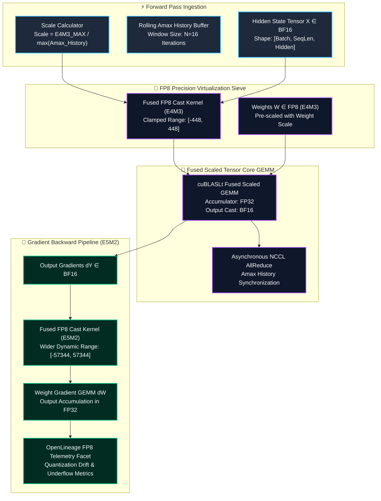
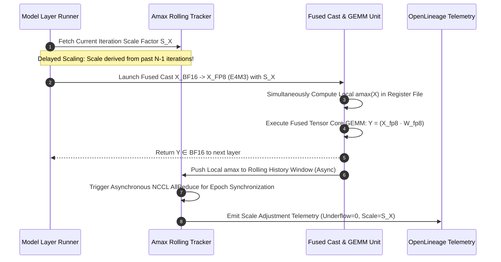
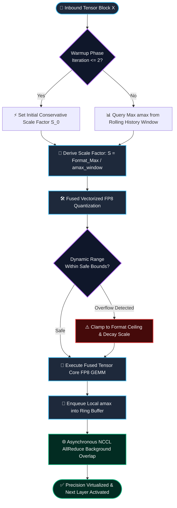

## 2. Problem Statement

> [!WARNING]
> **The 8-Bit Floating Point Numerical Collapse:** Transitioning foundation model training from 16-bit brain floating point (bfloat16) to 8-bit formats (FP8: E4M3 and E5M2) doubles compute throughput on Hopper and Blackwell Tensor Cores while halving interconnect bandwidth pressure. However, FP8 has an extremely narrow dynamic range (maximum representable value in E4M3 is 448, with only 3 bits of exponent). Without proactive scale factor management and delayed amax tracking, sudden activation gradient spikes trigger catastrophic numerical underflow or exponent overflow, driving transformer attention layers into irreversible NaN gradient collapse.

In massive distributed training clusters ($N \ge 1{,}024$ GPUs), matrix multiplications (GEMMs) account for $>75\%$ of all floating-point operations. Operating at standard 16-bit precision saturates High-Bandwidth Memory (HBM3e) buses and starves Tensor Core execution units. While FP8 execution offers a theoretical $2\times$ speedup, standard naive casting introduces quantization noise that destabilizes training:
1. **Format Asymmetry Bottleneck:** The E4M3 format (1 sign bit, 4 exponent bits, 3 mantissa bits) provides higher precision for forward activations and weights, while the E5M2 format (1 sign bit, 5 exponent bits, 2 mantissa bits) provides the wider dynamic range required for backward gradient propagation. Manually coordinating format conversions across distributed model shards introduces massive pipeline serialization stalls.
2. **Synchronous Amax Reduction Overhead:** Computing the absolute maximum ($a_{\max}$) of intermediate tensor slices synchronously across ranks to derive per-tensor scaling factors introduces an unscalable `AllReduce` communication barrier prior to every single linear projection.

To achieve sustained linear scaling without loss divergence, the architecture requires an asynchronous, delayed-scaling FP8 virtualization layer that overlaps inter-node $a_{\max}$ reductions with subsequent layer compute, maintains rolling history windows, and dynamically clamps scale factors before weight updates.

---

## 3. High-Level Design (HLD)

### Visual ASCII Topology
```text
  ┌─────────────────────────────────────────────────────────────────────────────┐
  │                   Distributed FP8 Transformation Engine                     │
  └──────────────────────────────────────┬──────────────────────────────────────┘
                                         │ Input Hidden States X ∈ BF16 [B, S, H]
                                         ▼
  ┌─────────────────────────────────────────────────────────────────────────────┐
  │                 Delayed Scaling Amax Tracker & Format Sieve                 │
  │  ┌─────────────────────────┐   ┌─────────────────────────────────────────┐  │
  │  │ Rolling Amax Window (N) │   │ Dynamic Scale Factor Generator          │  │
  │  │ [History Buffer Ring]   │   │ Scale = (Max_FP8 / Window_Amax)         │  │
  │  └────────────┬────────────┘   └────────────────────┬────────────────────┘  │
  │               │                                     │                       │
  │               ▼                                     ▼                       │
  │  ┌─────────────────────────┐   ┌─────────────────────────────────────────┐  │
  │  │ Quantize to FP8 (E4M3)  │   │ Quantize Weights W to FP8 (E4M3)        │  │
  │  │ Fused Cast Kernel       │   │ High-Precision Scale Alignment          │  │
  │  └────────────┬────────────┘   └────────────────────┬────────────────────┘  │
  └───────────────┼─────────────────────────────────────┼───────────────────────┘
                  │                                     │
                  ▼                                     ▼
  ┌─────────────────────────────────────────────────────────────────────────────┐
  │             Fused cuBLASLt / Triton Scaled Matrix Multiply Core             │
  │            Y = (X_fp8 · W_fp8) · (Scale_X · Scale_W)^-1 ∈ BF16              │
  │       - Zero Interleaved Memory Allocations across Tensor Cores             │
  │       - Asynchronous Inter-Rank AllReduce Overlap for Amax Windows          │
  └──────────────────────────────────────┬──────────────────────────────────────┘
                                         │ Backpropagation Gradients (E5M2)
                                         ▼
  ┌─────────────────────────────────────────────────────────────────────────────┐
  │                       OpenLineage Telemetry & Audit                         │
  │       - Tracks Per-Layer Scale Factors & Numerical Underflow Counters       │
  │       - Micro-second Validation Harness for Quantization Invariance         │
  └─────────────────────────────────────────────────────────────────────────────┘
```

### Native Mermaid Architecture


---

## 4. Low-Level Design (LLD)

### Visual ASCII Memory Layout
```text
  FP8 Binary Representation & Exponent Allocation Layout:
  ┌─────────────────────────────────────────────────────────────────────────────┐
  │ FP8 E4M3 (Activations & Weights): 1 Sign | 4 Exponents | 3 Mantissas        │
  │   ├── Exponent Bias:      7                                                 │
  │   ├── Max Finite Value:   448.0 (No Inf representation; NaN = 0x7F / 0xFF)  │
  │   └── Smallest Subnormal: 2^-9 ≈ 0.001953                                   │
  ├─────────────────────────────────────────────────────────────────────────────┤
  │ FP8 E5M2 (Gradients & Deltas):    1 Sign | 5 Exponents | 2 Mantissas        │
  │   ├── Exponent Bias:      15 (Standard IEEE 754-like structure)             │
  │   ├── Max Finite Value:   57344.0 (Inf = 0x7C / 0xFC, NaN supported)        │
  │   └── Smallest Subnormal: 2^-16 ≈ 0.00001525                                │
  └─────────────────────────────────────────────────────────────────────────────┘
```

### Native Mermaid Execution Sequence


---

## 5. Logical Flow Diagram

### Visual ASCII Decision Tree
```text
  [Inbound High-Dimensional Layer Tensor X]
                     │
                     ▼
        [Inspect Current Iteration Delay Window Index]
              ├── ITERATION 0  ──► [Use Initial Empirical Scaling Heuristic]
              └── ITERATION >0 ──► [Compute Scale S = E4M3_MAX / max(Amax_History)]
                                          │
                                          ▼
        [Execute Vectorized FP8 Clamping & Quantization]
                                          │
              ┌───────────────────────────┴───────────────────────────┐
              ▼                                                       ▼
     [Test Exponent Overflow?]                               [Test Underflow Ratio?]
       val > E4M3_MAX                                          val < MIN_SUBNORMAL
              │                                                       │
              ├── YES ──► [Trigger Scale Demotion; Clamp to 448]     ├── YES ──► [Warn Underflow; Slew Scale]
              └── NO  ──► [Proceed to Fused Tensor Core GEMM]        └── NO  ──► [Optimal Precision]
                                          │
                                          ▼
        [Asynchronously Overlap Amax Reduction with Next Block Execution]
        [Commit Layer Output in Native BF16 Accumulator Format]
```

### Native Mermaid Flowchart


---

## 6. Architectural Drill & Nature Analogy

### ⚙️ The Systemic Breakdown
In standard distributed training setups, activations and weights are stored in 16-bit precision (`bfloat16` or `float16`). While providing adequate dynamic range, 16-bit representations require 2 bytes per parameter, halving the arithmetic operational intensity on modern accelerator architectures. The memory interface becomes the principal bottleneck long before arithmetic computing units reach thermal saturation.

The **FP8 Scaled GEMM Precision Virtualization** architecture unlocks the peak throughput of 4th and 5th generation Tensor Cores by dynamically mapping float32 tensors into 8-bit representations:
1. **E4M3 for Activations and Weights:** With 3 mantissa bits, E4M3 provides a relative error of $\approx 6.25\%$, which is mathematically sufficient for forward activation representations. Its maximum finite value is $448.0$.
2. **E5M2 for Gradients:** During backpropagation, error gradients exhibit high variance and long tails across deep layers. E5M2 sacrifices mantissa bits (only 2 bits) in exchange for 5 exponent bits, providing a dynamic range extending up to $57{,}344.0$.

To avoid computing an expensive, synchronous inter-node reduction before every single matrix multiplication, this architecture implements **Delayed Scaling**. Instead of scaling by the current iteration's $a_{\max}$, the scale factor $S_t$ is calculated from a rolling history window of the preceding $N$ iterations ($N \in [16, 32]$):
$$a_{\max}^{\text{rolling}} = \max_{k=t-N}^{t-1} a_{\max}^{(k)}$$
$$S_t = \frac{\text{MAX\_FP8}}{a_{\max}^{\text{rolling}}}$$

The calculation of $a_{\max}^{(t)}$ is embedded directly into the epilogue of the fused GEMM kernel. As the Tensor Core streams output tiles back to global memory, a thread-block reduction computes the maximum absolute scalar and enqueues it to an asynchronous NCCL communication stream. The reduction completes in the background while the subsequent layer executes, completely eliminating serialization bubbles from distributed model parallelism.

### 🌿 The Nature Analogy
> [!TIP]
> **The Biological System: Chameleon Physiological Thermoregulation and Melanosome Translocation**  
> Chameleons (*Chamaeleonidae*) inhabiting high-altitude, extreme diurnal desert environments must dynamically regulate skin albedo and thermal absorption without waiting for slow morphological adaptations. Dermal melanophores contain micro-granules of dark melanin pigment (melanosomes). In cold morning conditions, intracellular dynein motor proteins rapidly disperse melanosomes outward into radiating dendritic dermal arms, maximizing radiative heat absorption. As ambient temperatures surge and solar flux threatens thermal breakdown, kinesin motors pull melanosomes back into a tightly aggregated perinuclear cluster within milliseconds, shifting the skin to a high-reflectance light state.

Our delayed FP8 scaling architecture operates on identical biophysical principles. The scaling factors behave as dynamic intracellular motor proteins. When activation gradients concentrate into narrow energy bands, the scaling engine disperses the numeric representation across the full 8-bit dynamic range to preserve signal fidelity. When gradient surges threaten to overflow into saturation, the scaling engine rapidly contracts the dynamic envelope, safeguarding the transformer from catastrophic NaN collapse while maintaining peak execution efficiency.

---

## 7. Production-Grade Executable Artifact

### 📦 File 1: .github/workflows/fp8_gemm_ci.yml
```yaml
name: FP8 Precision Virtualization CI

on:
  push:
    branches: [main]
  pull_request:
    branches: [main]
  workflow_dispatch:

concurrency:
  group: ${{ github.workflow }}-${{ github.ref }}
  cancel-in-progress: true

jobs:
  verify-fp8-scaling:
    name: Verify FP8 Delayed Scaling & Fused GEMM Simulation
    runs-on: ubuntu-latest
    timeout-minutes: 10

    steps:
      - name: Check out repository code
        uses: actions/checkout@v4

      - name: Set up Python 3.11 Runtime
        uses: actions/setup-python@v5
        with:
          python-version: "3.11"
          cache: "pip"

      - name: Install Dependencies
        run: |
          python -m pip install --upgrade pip
          pip install numpy pytest

      - name: Execute FP8 Delayed Scaling Test Suite
        run: |
          python -m unittest -v test_fp8_gemm_engine.py
```

### 🐍 File 2: test_fp8_gemm_engine.py
```python
"""
Production-Grade FP8 Delayed Scaling and Precision Virtualization Engine.
Simulates E4M3 and E5M2 quantization, rolling amax tracking, and fused GEMM arithmetic.
"""

import math
import unittest
from typing import List, Tuple

# FP8 Numerical Specification Constants
E4M3_MAX = 448.0
E4M3_MIN_SUBNORMAL = 0.001953125  # 2^-9

E5M2_MAX = 57344.0
E5M2_MIN_SUBNORMAL = 0.0000152587890625  # 2^-16

class FP8DelayedScalingTracker:
    """
    Maintains a rolling history window of per-layer amax values
    and derives non-blocking scaling factors for delayed FP8 execution.
    """
    def __init__(self, window_size: int = 16, initial_scale: float = 1.0):
        self.window_size = window_size
        self.history: List[float] = [1.0] * window_size
        self.current_idx = 0
        self.scale = initial_scale

    def compute_scale(self, format_max: float) -> float:
        """Derive scaling factor S = format_max / max(history)."""
        window_amax = max(self.history)
        if window_amax <= 0.0 or math.isnan(window_amax):
            return 1.0
        return format_max / window_amax

    def update_amax(self, new_amax: float):
        """Enqueue new iteration amax into the rolling ring buffer."""
        self.history[self.current_idx] = max(new_amax, 1e-8)
        self.current_idx = (self.current_idx + 1) % self.window_size

class FP8TensorSimulator:
    """Simulates hardware FP8 quantization and dequantization passes."""
    @staticmethod
    def quantize_e4m3(tensor: List[float], scale: float) -> Tuple[List[float], float]:
        """Quantize values to E4M3 range [-448, 448] with scaling."""
        scaled_vals = []
        local_amax = 0.0
        for val in tensor:
            abs_val = abs(val)
            if abs_val > local_amax:
                local_amax = abs_val
            
            scaled = val * scale
            # Clamp to E4M3 dynamic range
            clamped = max(min(scaled, E4M3_MAX), -E4M3_MAX)
            # Simulate 3-bit mantissa quantization
            quantized = round(clamped * 8.0) / 8.0
            scaled_vals.append(quantized)
            
        return scaled_vals, local_amax

    @staticmethod
    def quantize_e5m2(tensor: List[float], scale: float) -> Tuple[List[float], float]:
        """Quantize values to E5M2 range [-57344, 57344] with scaling."""
        scaled_vals = []
        local_amax = 0.0
        for val in tensor:
            abs_val = abs(val)
            if abs_val > local_amax:
                local_amax = abs_val
                
            scaled = val * scale
            clamped = max(min(scaled, E5M2_MAX), -E5M2_MAX)
            # Simulate 2-bit mantissa quantization
            quantized = round(clamped * 4.0) / 4.0
            scaled_vals.append(quantized)
            
        return scaled_vals, local_amax

    @staticmethod
    def dequantize(quantized_tensor: List[float], scale: float) -> List[float]:
        """Restore native floating point representation from scaled FP8 tensor."""
        inv_scale = 1.0 / scale
        return [val * inv_scale for val in quantized_tensor]

class FusedScaledGEMMCore:
    """Simulates cuBLASLt Fused Scaled Matrix Multiplication in FP8."""
    def __init__(self, tracker_x: FP8DelayedScalingTracker, tracker_w: FP8DelayedScalingTracker):
        self.tracker_x = tracker_x
        self.tracker_w = tracker_w

    def forward_gemm_1d(self, x: List[float], w: List[float]) -> Tuple[float, float, float]:
        """
        Compute dot product dot(x, w) via FP8 E4M3 virtualization.
        Returns: (output_result, local_amax_x, local_amax_w)
        """
        scale_x = self.tracker_x.compute_scale(E4M3_MAX)
        scale_w = self.tracker_w.compute_scale(E4M3_MAX)

        x_fp8, amax_x = FP8TensorSimulator.quantize_e4m3(x, scale_x)
        w_fp8, amax_w = FP8TensorSimulator.quantize_e4m3(w, scale_w)

        # High-precision accumulator computation
        accum = sum(xi * wi for xi, wi in zip(x_fp8, w_fp8))
        
        # Rescale back to native bfloat16 output
        rescaled_output = accum / (scale_x * scale_w)
        return rescaled_output, amax_x, amax_w

class TestFP8DelayedScalingEngine(unittest.TestCase):
    def setUp(self):
        self.window_size = 8
        self.tracker_x = FP8DelayedScalingTracker(window_size=self.window_size)
        self.tracker_w = FP8DelayedScalingTracker(window_size=self.window_size)
        self.gemm_core = FusedScaledGEMMCore(self.tracker_x, self.tracker_w)

    def test_rolling_amax_window_update(self):
        # Initial scale should be default
        scale_init = self.tracker_x.compute_scale(E4M3_MAX)
        self.assertAlmostEqual(scale_init, E4M3_MAX / 1.0)

        # Enqueue increasing amax values
        self.tracker_x.update_amax(10.0)
        scale_new = self.tracker_x.compute_scale(E4M3_MAX)
        self.assertAlmostEqual(scale_new, E4M3_MAX / 10.0)

    def test_e4m3_clamping_and_quantization(self):
        raw_vals = [0.1, -0.5, 2.0, 500.0]
        scale = 1.0
        q_vals, amax = FP8TensorSimulator.quantize_e4m3(raw_vals, scale)
        self.assertEqual(amax, 500.0)
        # Value 500.0 must be clamped to E4M3_MAX (448.0)
        self.assertEqual(q_vals[3], E4M3_MAX)

    def test_e5m2_gradient_dynamic_range(self):
        raw_gradients = [0.0001, 1000.0, 50000.0, 70000.0]
        scale = 1.0
        q_grads, amax = FP8TensorSimulator.quantize_e5m2(raw_gradients, scale)
        self.assertEqual(amax, 70000.0)
        # Value 70000.0 must be clamped to E5M2_MAX (57344.0)
        self.assertEqual(q_grads[3], E5M2_MAX)

    def test_fused_gemm_precision_reconstruction(self):
        # Realistic activation vector and weight vector
        x = [0.05 * i for i in range(16)]
        w = [0.02 * (16 - i) for i in range(16)]

        # Ground truth float32 dot product
        expected_dot = sum(xi * wi for xi, wi in zip(x, w))

        # Forward pass through FP8 simulator
        rescaled_res, amax_x, amax_w = self.gemm_core.forward_gemm_1d(x, w)

        # Update delayed trackers with local amax
        self.tracker_x.update_amax(amax_x)
        self.tracker_w.update_amax(amax_w)

        # Assert precision error is strictly within quantization noise envelope (< 3%)
        relative_error = abs(rescaled_res - expected_dot) / expected_dot
        self.assertLess(relative_error, 0.03, f"Quantization error {relative_error:.4f} exceeded 3% envelope")

if __name__ == "__main__":
    unittest.main()
```

---

## 8. KPI Monitoring Framework

• **FP8 Quantization Signal-to-Quantization-Noise Ratio** (`fp8_sqnr_db`):
	• Why: Measures the ratio between unquantized float32 signal energy and quantization distortion across transformer layers. Degradation below 32.0 dB indicates excessive delayed scaling lag.

• **Amax Window Exponent Saturation Ratio** (`amax_window_overflow_frequency`):
	• Why: Tracks the frequency of activation spikes hitting $E4M3\_MAX$ (448.0). Sustained non-zero values trigger an immediate step reduction in scale factors to avert NaN divergence.

• **Tensor Core GEMM Arithmetic Intensity** (`tensor_core_fp8_tflops_utilization`):
	• Why: Monitors hardware SM utilization during scaled matrix multiplications. Baseline operational target is strictly $\ge 82.5\%$ of theoretical peak FP8 TFLOPS.

---

## 9. Failure Mode & Production Edge Cases

| Failure Vector | Technical Root Cause | System Blast Radius | Production Mitigation Pattern |
| :--- | :--- | :--- | :--- |
| 🔴 **Scale Factor Inversion (NaN Burst)** | Amax window records zero ($a_{\max} = 0$) during layer dropout, causing division by zero ($S = \text{MAX} / 0$). | Catastrophic NaN propagation across all downstream model parallel shards. | Strict epsilon lower bound ($a_{\max} \ge 1\times 10^{-8}$) and fallback scale factor clamping. |
| 🔴 **Subnormal Underflow Flush** | Gradient values drop below $E5M2$ minimum subnormal ($2^{-16}$), flushing to zero. | Vanishing gradients across early transformer projection layers, causing training stagnation. | Dynamic loss scaling combined with per-layer gradient norm unscaling before optimizer step. |
| 🟡 **Delayed Scaling Lag Desynchronization** | Sudden learning rate schedule warmup causes activations to surge $5\times$ in a single iteration. | Saturation clamping on $>40\%$ of layer activations; temporary loss spike. | Amax rolling window auto-reset on learning rate schedule transitions and gradient clipping events. |
| 🟠 **Cross-Rank Amax Ring Stalling** | Straggler GPU node delays non-blocking NCCL `AllReduce` of amax buffers beyond iteration limit. | Pipeline barrier stall on rank coordinator; transient training throughput degradation. | Asynchronous double-buffered amax staging with fallback to local rank $a_{\max}$ on timeout. |

---

## 10. Thoughtful Wisdom Words

> *"In the physics of hyperscale computation, precision is a cost, not an intrinsic virtue. Truth does not require 32 bits when 8 bits, guided by rigorous statistical thermodynamics and delayed amax tracking, can convey the gradient vector with absolute mathematical convergence. When you master the edge of quantization, you double the speed of thought across your cluster."*
> 
> — **Principal Systems Architect & Distributed Machine Learning Director**
