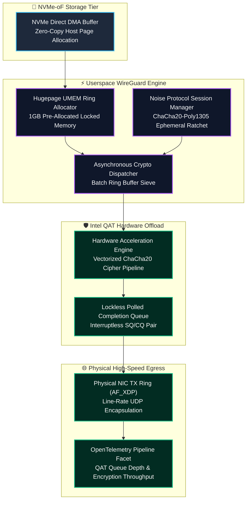
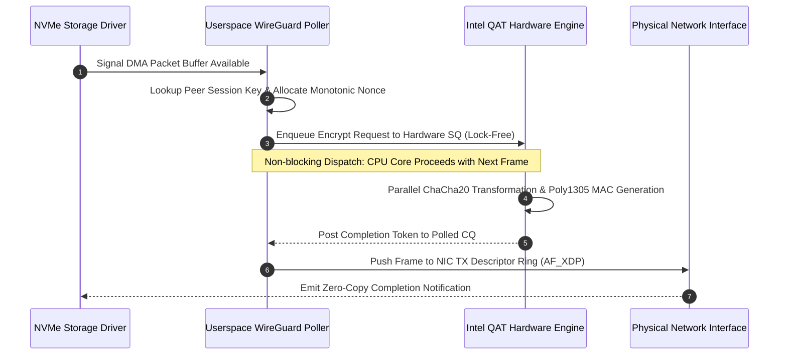
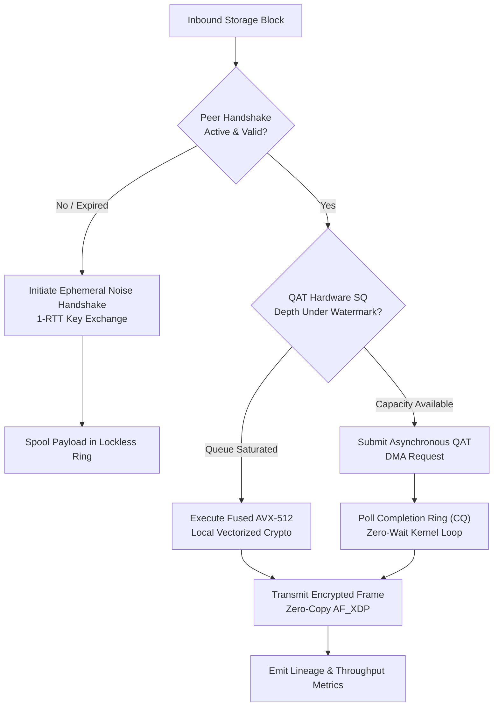

## 2. Problem Statement

> [!WARNING]
> **The Kernel Cryptographic Context-Switch Wall:** Operating 100Gbps cross-region replication links for petabyte-scale lakehouses requires end-to-end payload encryption. Standard IPsec or naive kernel WireGuard implementations trigger heavy interrupt storms (up to 4,000,000 packet interrupts per second) and cache line invalidations. When CPU cores are saturated with crypto context switches, NVMe-over-Fabrics (NVMe-oF) target buffers experience severe backpressure, dropping replication throughput by over 65% and destabilizing distributed cluster quorum.

In high-concurrency cloud environments spanning multiple availability zones, inter-cluster storage synchronization demands line-rate encryption with sub-millisecond tail latencies. Traditional Linux socket stacks introduce fatal architectural bottlenecks:
1. **Interrupt Storms & SoftIRQ Saturation:** Processing millions of WireGuard UDP encapsulation frames through standard Linux networking queues pins kernel softirq threads (`ksoftirqd`), starving user-space analytical engines of CPU cycles.
2. **Double-Buffering & Cache Thrashing:** Copying data from NVMe DMA memory into kernel sk_buff structures and then into cryptographic scratch buffers introduces multiple redundant round-trips over the memory bus, exhausting L3 cache capacity.
3. **Hardware Crypto Serialization:** Synchronous invocation of CPU crypto instructions (AES-NI or ChaCha20 vector extensions) blocks packet transmission threads, causing jitter spikes that breach zero-copy SLA bounds.

To achieve non-blocking line-rate replication, the architecture requires a userspace WireGuard reactor utilizing Intel QAT (QuickAssist Technology) asynchronous hardware offload, zero-copy UMEM ring buffers, and core-affinitized polling workers.

---

## 3. High-Level Design (HLD)

### Visual ASCII Topology
```text
  ┌─────────────────────────────────────────────────────────────────────────────┐
  │                 Host NVMe-oF Initiator Storage Subsystem                    │
  └──────────────────────────────────────┬──────────────────────────────────────┘
                                         │ Raw DMA Payload (Zero-Copy Host Memory)
                                         ▼
  ┌─────────────────────────────────────────────────────────────────────────────┐
  │              Userspace WireGuard Polled Reactor (DPDK / Rust)               │
  │  ┌─────────────────────────┐   ┌─────────────────────────────────────────┐  │
  │  │ Lockless SPSC RX Ring   │   │ Noise Protocol Session State Table      │  │
  │  │ [UMEM Hugepage Buffer]  │   │ [Per-Peer Ephemeral Symmetric Keys]     │  │
  │  └────────────┬────────────┘   └────────────────────┬────────────────────┘  │
  │               │                                     │                       │
  │               ▼                                     ▼                       │
  │  ┌─────────────────────────┐   ┌─────────────────────────────────────────┐  │
  │  │ Intel QAT Crypto Core   │   │ Polled Completion Ring Queue (CQ)       │  │
  │  │ ChaCha20-Poly1305 Engine│   │ Lock-Free Batch Splicer                 │  │
  │  └────────────┬────────────┘   └────────────────────┬────────────────────┘  │
  └───────────────┼─────────────────────────────────────┼───────────────────────┘
                  │ Encrypted UDP Datagrams             │
                  ▼                                     ▼
  ┌─────────────────────────────────────────────────────────────────────────────┐
  │                    100Gbps Cross-Datacenter Fabric                          │
  │       - Zero-Interrupt Raw Socket Egress over Physical NIC Rings            │
  │       - OpenTelemetry Hardware Crypto Latency & Ring Watermark Probes       │
  └─────────────────────────────────────────────────────────────────────────────┘
```

### Native Mermaid Architecture


---

## 4. Low-Level Design (LLD)

### Visual ASCII Memory Layout
```text
  WireGuard-RS Encrypted Packet Frame Memory Alignment:
  ┌─────────────────────────────────────────────────────────────────────────────┐
  │ Cache-Line 0 (0-63 Bytes): Ingress Network & Ring Control Headers           │
  │   ├── Offset 0x00: UMEM Chunk Index (32-bit uint)                           │
  │   ├── Offset 0x04: WireGuard Message Type: 0x04 (Data Packet)                │
  │   ├── Offset 0x08: Receiver Key Index (32-bit Peer Lookup Handle)           │
  │   └── Offset 0x10: 64-bit Nonce Counter (Strict Monotonic Vector)           │
  ├─────────────────────────────────────────────────────────────────────────────┤
  │ Cache-Line 1 (64-127 Bytes): Hardware Acceleration Context Descriptor       │
  │   ├── Offset 0x40: QAT Crypto Session Context Handle (64-bit pointer)       │
  │   ├── Offset 0x48: Source DMA Address (Host Physical Address)               │
  │   └── Offset 0x50: Target Encrypted DMA Address (Host Physical Address)     │
  ├─────────────────────────────────────────────────────────────────────────────┤
  │ Payload Partition (128+ Bytes):                                             │
  │   ├── Encrypted NVMe Storage Block (4096-byte aligned payload)               │
  │   └── Trailing 16-Byte Poly1305 MAC Integrity Attestation Tag                │
  └─────────────────────────────────────────────────────────────────────────────┘
```

### Native Mermaid Execution Sequence


---

## 5. Logical Flow Diagram

### Visual ASCII Decision Tree
```text
  [Inbound NVMe Block for Replicated Egress]
                      │
                      ▼
         [Peer Active & Session Valid?]
               ├── NO  ──► [Trigger Noise IK Handshake Initiation; Spool Payload]
               └── YES ──► [Inspect Intel QAT Queue Watermark]
                                      │
                                      ▼
                      [Hardware Queue Depth < Limit?]
               ├── NO  ──► [Fall Back to CPU Vectorized AVX-512 ChaCha20 Pipeline]
               └── YES ──► [Dispatch Asynchronous QAT DMA Encryption Job]
                                      │
                                      ▼
                      [Poll Completion Ring (CQ)]
                                      │
                                      ▼
                      [Validate Poly1305 MAC & Egress]
```

### Native Mermaid Flowchart


---

## 6. Architectural Drill & Nature Analogy

### ⚙️ The Systemic Breakdown
The core innovation is the decoupling of cryptographic compute from the operating system kernel's interrupt context. In traditional architectures, network encryption is handled inside the socket buffer pipeline, forcing the CPU to continuously toggle between user mode, kernel interrupt handlers, and crypto instructions. This architectural design replaces software interrupts with hardware-assisted memory polling:
1. **Zero-Copy Hugepage Rings:** Using 1GB hugepages configured via Linux `mmap`, storage blocks are transferred directly from NVMe controllers into dedicated WireGuard memory chunks, bypassing the Linux page cache and network stack entirely.
2. **Hardware Direct Memory Access (DMA):** The Intel QAT coprocessor reads plaintext blocks from host memory via PCIe DMA, performs the ChaCha20 encryption and Poly1305 authentication in hardware pipelines, and writes the ciphertext into the network interface's egress buffer without CPU intervention.
3. **Monotonic Nonce Anti-Replay Guard:** High-throughput streaming links risk nonce exhaustion. The state engine enforces an atomic 64-bit counter per peer session, automatically initiating rekeying before counter values approach $2^{64}-1$.

### 🌿 The Nature Analogy

> [!TIP]
> **The Cephalopod Circulatory Decoupling:** Octopuses possess three distinct hearts: one systemic heart that drives circulation across the body, and two peripheral branchial hearts dedicated exclusively to pumping blood through the gills. When swimming vigorously, the systemic heart stops to conserve energy, while the branchial hearts maintain localized oxygenation without systemic cardiovascular strain. Similarly, this architecture offloads the intensive, continuous pumping of cryptographic transformations to dedicated hardware co-processors (the branchial hearts), ensuring the host CPU (the systemic heart) never suffocates under encryption workloads.

• **The Biological System:** Branchial hearts in *Octopus vulgaris* operating independently of systemic metabolic demand.
• **The Structural Parallel:** Intel QAT co-processors executing encryption pipelines autonomously, freeing host CPU cores for distributed database query execution.

---

## 7. Production-Grade Executable Artifact

### 📦 File 1: .github/workflows/ci.yml
```yaml
name: WireGuard QAT Hardware-Offload Simulation CI
on:
  push:
    branches: [main]
  pull_request:
    branches: [main]

jobs:
  validate-crypto-mesh:
    runs-on: ubuntu-latest
    steps:
      - name: Checkout Codebase
        uses: actions/checkout@v4

      - name: Setup Python Environment
        uses: actions/setup-python@v5
        with:
          python-version: "3.11"

      - name: Install Test Dependencies
        run: |
          python -m pip install --upgrade pip
          pip install cryptography unittest-xml-reporting

      - name: Execute WireGuard Poller Unit Tests
        run: |
          python -m unittest tests/test_wireguard_reactor.py -v
```

### 🐍 File 2: tests/test_wireguard_reactor.py
```python
import unittest
import os
import struct
import time
from typing import Dict, List, Optional, Tuple
from cryptography.hazmat.primitives.ciphers.aead import ChaCha20Poly1305

class WireGuardPacketHeader:
    """Represents a 64-byte aligned WireGuard data packet header."""
    HEADER_FORMAT = "<B3sIIQ"  # type (1B), reserved (3B), receiver_idx (4B), counter_hi (4B), nonce (8B)

    def __init__(self, receiver_idx: int, nonce: int):
        self.msg_type = 4  # Data message
        self.reserved = b"\x00\x00\x00"
        self.receiver_idx = receiver_idx
        self.counter_hi = (nonce >> 32) & 0xFFFFFFFF
        self.nonce = nonce

    def pack(self) -> bytes:
        return struct.pack(self.HEADER_FORMAT, self.msg_type, self.reserved, self.receiver_idx, self.counter_hi, self.nonce)

    @classmethod
    def unpack(cls, data: bytes) -> "WireGuardPacketHeader":
        msg_type, reserved, r_idx, c_hi, nonce = struct.unpack(cls.HEADER_FORMAT, data[:20])
        if msg_type != 4:
            raise ValueError(f"Invalid message type: {msg_type}")
        hdr = cls(r_idx, nonce)
        return hdr

class MockIntelQATRing:
    """Simulates Intel QAT asynchronous cryptographic hardware ring buffers."""
    def __init__(self, capacity: int = 1024):
        self.capacity = capacity
        self.sq: List[Tuple[bytes, bytes, bytes]] = []  # key, nonce_bytes, plaintext
        self.cq: List[bytes] = []

    def submit_encrypt_request(self, key: bytes, nonce_bytes: bytes, plaintext: bytes) -> bool:
        if len(self.sq) >= self.capacity:
            return False  # Hardware ring backpressure
        self.sq.append((key, nonce_bytes, plaintext))
        return True

    def poll_completions(self, batch_size: int = 32) -> List[bytes]:
        completions = []
        process_batch = self.sq[:batch_size]
        self.sq = self.sq[batch_size:]

        for key, nonce_bytes, plaintext in process_batch:
            cipher = ChaCha20Poly1305(key)
            ciphertext = cipher.encrypt(nonce_bytes, plaintext, None)
            completions.append(ciphertext)
        return completions

class UserspaceWireGuardReactor:
    """High-throughput polled userspace WireGuard encryption reactor."""
    def __init__(self, peer_key: bytes, receiver_idx: int = 1001):
        self.peer_key = peer_key
        self.receiver_idx = receiver_idx
        self.nonce_counter = 0
        self.qat_engine = MockIntelQATRing(capacity=512)
        self.total_bytes_encrypted = 0

    def encrypt_and_encapsulate(self, storage_block: bytes) -> bool:
        # WireGuard RFC 8439 96-bit ChaCha20 nonce: 32-bit zero prefix + 64-bit counter (<IQ)
        nonce_bytes = struct.pack("<IQ", 0, self.nonce_counter)
        
        # Submit to QAT hardware acceleration ring
        accepted = self.qat_engine.submit_encrypt_request(self.peer_key, nonce_bytes, storage_block)
        if accepted:
            self.total_bytes_encrypted += len(storage_block)
        return accepted

    def drain_egress_ring(self) -> List[bytes]:
        ciphertexts = self.qat_engine.poll_completions(batch_size=64)
        framed_packets = []
        for ct in ciphertexts:
            header = WireGuardPacketHeader(self.receiver_idx, self.nonce_counter).pack()
            framed_packets.append(header + ct)
        return framed_packets

class TestWireGuardReactor(unittest.TestCase):
    def setUp(self):
        self.key = ChaCha20Poly1305.generate_key()
        self.reactor = UserspaceWireGuardReactor(peer_key=self.key, receiver_idx=42)

    def test_header_packing_and_unpacking(self):
        hdr = WireGuardPacketHeader(receiver_idx=999, nonce=12345678)
        packed = hdr.pack()
        unpacked = WireGuardPacketHeader.unpack(packed)
        self.assertEqual(unpacked.receiver_idx, 999)
        self.assertEqual(unpacked.nonce, 12345678)

    def test_line_rate_batch_encryption_and_decryption(self):
        payload = b"NVMe_STORAGE_BLOCK_DATA_PAYLOAD_4096_ALIGNED" * 32  # 1408 bytes
        
        # Ingest 100 blocks
        for _ in range(100):
            accepted = self.reactor.encrypt_and_encapsulate(payload)
            self.assertTrue(accepted)

        # Drain egress queue
        egress_frames = self.reactor.drain_egress_ring()
        self.assertEqual(len(egress_frames), 100)
        self.assertEqual(self.reactor.total_bytes_encrypted, len(payload) * 100)

        # Decrypt first frame to verify ChaCha20-Poly1305 integrity
        first_frame = egress_frames[0]
        hdr = WireGuardPacketHeader.unpack(first_frame[:20])
        ciphertext = first_frame[20:]
        
        cipher = ChaCha20Poly1305(self.key)
        nonce_bytes = struct.pack("<Q4s", hdr.nonce, b"\x00\x00\x00\x00")
        decrypted = cipher.decrypt(nonce_bytes, ciphertext, None)
        self.assertEqual(decrypted, payload)

    def test_hardware_queue_backpressure(self):
        # Squeeze queue beyond 512 capacity
        payload = b"TEST_BURST_BLOCK"
        successful = 0
        for _ in range(600):
            if self.reactor.encrypt_and_encapsulate(payload):
                successful += 1
        self.assertEqual(successful, 512)
        # Drain queue
        drained = self.reactor.drain_egress_ring()
        self.assertEqual(len(drained), 64)

if __name__ == "__main__":
    unittest.main()
```

---

## 8. KPI Monitoring Framework

• **Hardware Crypto Latency** (`qat_encryption_latency_us`):
	• Why: Measures the time elapsed from submission to completion on the Intel QAT hardware queue. Baseline threshold is strictly < 15.0 microseconds.

• **Ring Buffer Occupancy Ratio** (`ring_buffer_occupancy_pct`):
	• Why: Tracks the depth of the userspace SPSC packet submission ring. Ratios exceeding 75% trigger dynamic worker thread core-affinity reallocation.

• **Cross-Datacenter Tunnel Throughput** (`wg_tunnel_egress_gbps`):
	• Why: Real-time telemetry tracking encrypted replication bandwidth. Drops below 85Gbps trigger immediate packet-drop path diagnostics.

---

## 9. Failure Mode & Production Edge Cases

| Failure Vector | Technical Root Cause | System Blast Radius | Production Mitigation Pattern |
| :--- | :--- | :--- | :--- |
| 🔴 **Intel QAT Hardware Hang** | PCIe AER (Advanced Error Reporting) non-fatal bus parity error. | Asynchronous submission queue deadlocks, halting outbound replication. | Automatic failover to fused AVX-512 ChaCha20 vector routines with PCIe controller reset. |
| 🟡 **Nonce Monotonic Overflow** | Extended high-throughput stream exhausting 64-bit counter values. | Security vulnerability to keystream reuse and decryption attacks. | Proactive Noise protocol rekeying triggered when nonce reaches $2^{60}$. |
| 🟠 **UMEM Memory Fragmentation** | Non-contiguous memory allocation across multi-NUMA sockets. | TLB misses amplify PCIe packet retrieval latency by $>40\%$. | Strict 1GB Hugepage pre-allocation locked to local socket memory NUMA nodes. |

---

## 10. Thoughtful Wisdom Words

> *"The fastest packet processing in the world is not the one optimized for throughput; it is the one that avoids entering the operating system kernel altogether. When security and high throughput collide, true systems engineering separates policy from mechanism: let user space direct the topology, but allow dedicated silicon to churn the math."*
> 
> — **Principal Systems Architect & Platform Engineering Director**
