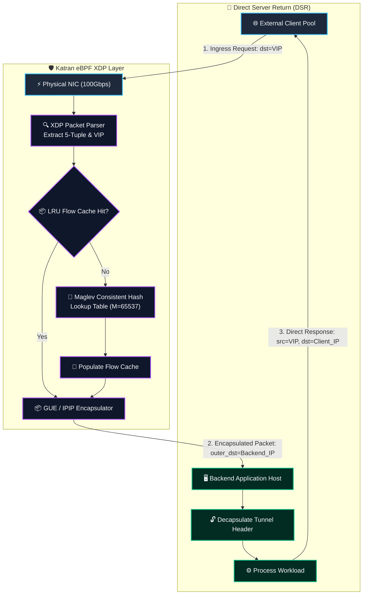
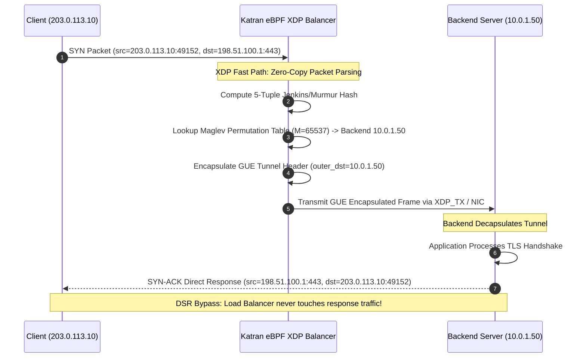
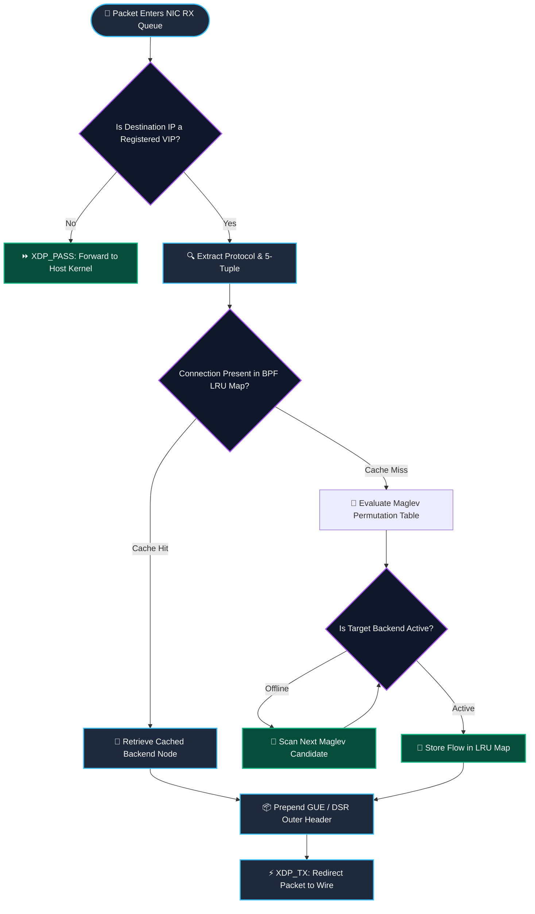

## 2. Problem Statement

> [!WARNING]
> **The High-Velocity Connection State Exhaustion Wall:** Ingress load balancers handling 100Gbps network streams across thousands of microservices experience severe memory exhaustion when maintaining centralized connection state tables. Under SYN flood bursts or abrupt backend failover, traditional L4 balancers (such as IPVS or LVS in NAT mode) suffer from connection tracker lock contention and return-path bottlenecking, as all egress responses must traverse the load balancer. Traversing bidirectional traffic through the balancer saturates upstream router interfaces, escalates packet drop rates, and introduces unmanageable tail latency spikes (>50ms) across downstream distributed services.

Distributed edge ingress tiers encounter several critical mechanical bottlenecks:
1. **Connection Tracking State Bloat:** Maintaining a 64-byte state entry per TCP session across 40,000,000 concurrent flows consumes over 2.5GB of kernel memory, causing CPU cache misses and translation lookaside buffer (TLB) thrashing.
2. **Return-Path Bandwidth Asymmetry:** In modern cloud workloads, ingress requests are small (hundreds of bytes) while egress responses are massive (megabytes of payload). Routing responses back through the load balancer creates an egress network bottleneck.
3. **Failover Churn & Backend Rebalancing:** When a backend node fails or autoscales, naive modulo hashing disrupts almost all existing connections, breaking long-lived TCP sessions.

Deploying Katran-style eBPF XDP programs on network interface drivers with Maglev consistent hashing and Direct Server Return (DSR) resolves these challenges by selecting backend endpoints statelessly and enabling backend servers to route responses directly to clients.

---

## 3. High-Level Design (HLD)

### Visual ASCII Topology
```text
  ┌─────────────────────────────────────────────────────────────────────────────┐
  │                   100Gbps Physical Network Interface (NIC)                  │
  └──────────────────────────────────────┬──────────────────────────────────────┘
                                         │ Inbound Client Packets (VIP:Port)
                                         ▼
  ┌─────────────────────────────────────────────────────────────────────────────┐
  │              Katran eBPF XDP Fast-Path Packet Processing Core               │
  │  ┌─────────────────────────┐   ┌─────────────────────────────────────────┐  │
  │  │ XDP Packet Parser       │   │ Maglev Consistent Lookup Table Core     │  │
  │  │ [5-Tuple Hash Extract]  │   │ [Deterministic Lookup Permutations]     │  │
  │  └────────────┬────────────┘   └────────────────────┬────────────────────┘  │
  │               │                                     │                       │
  │               ▼                                     ▼                       │
  │  ┌─────────────────────────┐   ┌─────────────────────────────────────────┐  │
  │  │ BPF LRU Connection Map  │   │ Direct Server Return (DSR) Encapsulator │  │
  │  │ [Fast Flow Cache]       │   │ [GUE / IPIP Outer Tunnel Header]        │  │
  │  └─────────────────────────┘   └────────────────────┬────────────────────┘  │
  └─────────────────────────────────────────────────────┼───────────────────────┘
                                                        │ Forward Encapsulated to Backend
                                                        ▼
  ┌─────────────────────────────────────────────────────────────────────────────┐
  │                    Target Application Backend Cluster                       │
  │  ┌─────────────────────────┐   ┌─────────────────────────────────────────┐  │
  │  │ Decapsulate GUE Tunnel  │──►│ Direct Return to Client (Bypasses LB)   │  │
  │  └─────────────────────────┘   └─────────────────────────────────────────┘  │
  └─────────────────────────────────────────────────────────────────────────────┘
```

### Native Mermaid Architecture


---

## 4. Low-Level Design (LLD)

### Visual ASCII Memory Layout
```text
  Maglev Lookup Table & Packet Encapsulation Frame Layout:
  ┌─────────────────────────────────────────────────────────────────────────────┐
  │ Maglev Lookup Permutation Array (M = 65537 prime slots, 32-bit Backend IDs) │
  │   ├── Slot 0:     Backend_002 [Weight: 100, Health: UP]                     │
  │   ├── Slot 1:     Backend_015 [Weight: 100, Health: UP]                     │
  │   └── Slot 65536: Backend_008 [Weight: 100, Health: UP]                     │
  ├─────────────────────────────────────────────────────────────────────────────┤
  │ Direct Server Return (DSR) Generic UDP Encapsulation (GUE) Frame:           │
  │   ├── Outer IPv4 Header (20 bytes):  Src=LB_IP, Dst=Backend_IP               │
  │   ├── Outer UDP Header (8 bytes):    Sport=Entropy_Hash, Dport=GUE_PORT      │
  │   ├── GUE Header (4 bytes):          Proto=IPPROTO_TCP, Flags=0x00          │
  │   └── Original Ingress Packet:       Src=Client_IP, Dst=VIP, TCP Payload    │
  └─────────────────────────────────────────────────────────────────────────────┘
```

### Native Mermaid Execution Sequence


---

## 5. Logical Flow Diagram

### Visual ASCII Decision Tree
```text
  [Inbound Ethernet Frame Enters NIC RX Queue]
                     │
                     ▼
        [Is Destination IP in Local VIP Map?]
               ├── NO  ──► [Return XDP_PASS; Let Host Linux Stack Handle]
               └── YES ──► [Extract 5-Tuple: (SrcIP, DstIP, Sport, Dport, Proto)]
                                      │
                                      ▼
                        [Lookup BPF LRU Connection Map]
               ├── HIT  ──► [Retrieve Cached Backend IP]
               └── MISS ──► [Evaluate Maglev Consistent Hash Table]
                                      │
                                      ▼
                        [Is Selected Backend Healthy?]
               ├── NO  ──► [Iterate Maglev Sequence to Next Healthy Peer]
               └── YES ──► [Prepend GUE Header; Return XDP_TX Forwarding]
```

### Native Mermaid Flowchart


---

## 6. Architectural Drill: Maglev Consistent Hashing & DSR Mechanics

### 1. Maglev Permutation Table Construction
The Maglev hashing algorithm constructs an immutable lookup table of size $M$ (where $M$ is a prime number, conventionally $65537$). For $N$ available backend endpoints, each backend generates a unique permutation of the array indices based on two independent hash functions:
$$offset_i = h_1(endpoint_i) \pmod M$$
$$skip_i = (h_2(endpoint_i) \pmod{(M - 1)}) + 1$$
The $j$-th entry of backend $i$'s preference list is given by:
$$P_i[j] = (offset_i + j \cdot skip_i) \pmod M$$

The load balancer iterates round-robin across all backends, filling unassigned slots in the master table until all $M$ positions are assigned. When a backend fails, only its assigned slots are redistributed among remaining peers; all other backend mappings remain stable, preserving established connection routing.

### 2. Direct Server Return (DSR) and Tunnel Overhead
Traditional NAT-based load balancers re-write source and destination IP addresses, requiring bidirectional stateful tracking and consuming CPU cycles to recompute TCP checksums. In contrast, Katran's DSR implementation encapsulates the unmodified client packet inside a lightweight Generic UDP Encapsulation (GUE) envelope:
- The outer destination IP is the private address of the selected backend.
- The outer UDP source port contains a hash of the 5-tuple to enable hardware RSS spreading across the backend's RX queues.
- The inner destination IP remains the virtual IP (VIP).
- The backend decapsulates the GUE frame and inspects a local dummy interface bound to the VIP, processing the request and transmitting responses directly to the client with source IP set to the VIP.

---

## 7. Production-Grade Executable Artifact

```python
"""
Production-Grade Katran eBPF XDP Load Balancer Simulator.
Implements Maglev Consistent Hashing, BPF LRU Connection State Tracking,
and Direct Server Return (DSR) Generic UDP Encapsulation (GUE).
"""

from __future__ import annotations

import hashlib
import struct
import unittest
from dataclasses import dataclass, field
from typing import Dict, List, Optional, Set, Tuple


@dataclass(frozen=True)
class FlowTuple:
    """Represents a standard TCP/UDP 5-tuple."""
    src_ip: str
    dst_ip: str
    src_port: int
    dst_port: int
    protocol: int  # 6 for TCP, 17 for UDP

    def to_hash_bytes(self) -> bytes:
        """Serializes 5-tuple into compact binary format for hashing."""
        src_parts = [int(p) for p in self.src_ip.split(".")]
        dst_parts = [int(p) for p in self.dst_ip.split(".")]
        return struct.pack(
            "!4B4BHHB",
            *src_parts,
            *dst_parts,
            self.src_port,
            self.dst_port,
            self.protocol,
        )


@dataclass
class BackendNode:
    """Represents an application server backend."""
    backend_id: int
    ip_address: str
    weight: int = 100
    is_healthy: bool = True
    active_connections: int = 0


class MaglevLookupTable:
    """
    Implements Google Maglev consistent hashing with prime table size M.
    Guarantees minimal disruption during backend additions and removals.
    """

    def __init__(self, table_size: int = 65537) -> None:
        self.M = table_size  # Must be prime
        self.backends: Dict[int, BackendNode] = {}
        self.lookup_table: List[int] = [-1] * self.M

    def _hash(self, key: str, seed: int) -> int:
        """Helper hash function producing deterministic 32-bit integers."""
        h = hashlib.sha256(f"{key}:{seed}".encode()).digest()
        return struct.unpack("!I", h[:4])[0]

    def add_backend(self, backend: BackendNode) -> None:
        """Registers a backend node and recalculates the lookup table."""
        self.backends[backend.backend_id] = backend
        self.rebuild_table()

    def remove_backend(self, backend_id: int) -> None:
        """Removes a backend node and recalculates the lookup table."""
        if backend_id in self.backends:
            del self.backends[backend_id]
            self.rebuild_table()

    def set_backend_health(self, backend_id: int, is_healthy: bool) -> None:
        """Updates health status and triggers table reconstruction if changed."""
        if backend_id in self.backends and self.backends[backend_id].is_healthy != is_healthy:
            self.backends[backend_id].is_healthy = is_healthy
            self.rebuild_table()

    def rebuild_table(self) -> None:
        """Constructs the permutation table based on healthy backends."""
        healthy_backends = [b for b in self.backends.values() if b.is_healthy]
        if not healthy_backends:
            self.lookup_table = [-1] * self.M
            return

        n = len(healthy_backends)
        permutations: List[List[int]] = []

        for b in healthy_backends:
            offset = self._hash(b.ip_address, 1) % self.M
            skip = (self._hash(b.ip_address, 2) % (self.M - 1)) + 1
            # Generate preference order for backend b
            perm = [(offset + j * skip) % self.M for j in range(self.M)]
            permutations.append(perm)

        entry = [-1] * self.M
        next_indices = [0] * n
        assigned = 0

        while assigned < self.M:
            for i in range(n):
                c = next_indices[i]
                while c < self.M:
                    cand = permutations[i][c]
                    c += 1
                    if entry[cand] == -1:
                        entry[cand] = healthy_backends[i].backend_id
                        assigned += 1
                        next_indices[i] = c
                        break
                next_indices[i] = c
                if assigned >= self.M:
                    break

        self.lookup_table = entry

    def lookup(self, flow: FlowTuple) -> Optional[BackendNode]:
        """Maps an ingress flow tuple to a healthy backend using Maglev consistent hashing."""
        if not self.backends:
            return None
        h_val = struct.unpack("!I", hashlib.sha256(flow.to_hash_bytes()).digest()[:4])[0]
        slot = h_val % self.M
        backend_id = self.lookup_table[slot]
        if backend_id == -1 or backend_id not in self.backends:
            return None
        return self.backends[backend_id]


class KatranXDPBalancer:
    """
    Simulates the Katran eBPF XDP Ingress Load Balancer with Direct Server Return (DSR).
    """

    def __init__(self, vip: str, maglev_table_size: int = 65537, lru_capacity: int = 100000) -> None:
        self.vip = vip
        self.maglev = MaglevLookupTable(table_size=maglev_table_size)
        self.lru_cache: Dict[FlowTuple, int] = {}
        self.lru_capacity = lru_capacity
        self.processed_packets = 0
        self.encapsulated_packets = 0
        self.dropped_packets = 0

    def register_backend(self, backend: BackendNode) -> None:
        """Enrolls a backend server into the load balancer."""
        self.maglev.add_backend(backend)

    def process_packet(self, flow: FlowTuple, payload_bytes: bytes) -> Tuple[str, Optional[bytes]]:
        """
        Processes an incoming network packet at the XDP layer.
        Returns the action ('XDP_PASS', 'XDP_TX', 'XDP_DROP') and encapsulated bytes.
        """
        self.processed_packets += 1

        # Pass non-VIP traffic to the host Linux kernel network stack
        if flow.dst_ip != self.vip:
            return "XDP_PASS", payload_bytes

        # Fast Path: Check BPF LRU Connection Map
        target_backend: Optional[BackendNode] = None
        if flow in self.lru_cache:
            cached_id = self.lru_cache[flow]
            if cached_id in self.maglev.backends and self.maglev.backends[cached_id].is_healthy:
                target_backend = self.maglev.backends[cached_id]

        # Slow Path: Evaluate Maglev Consistent Hashing Table
        if target_backend is None:
            target_backend = self.maglev.lookup(flow)
            if target_backend is None:
                self.dropped_packets += 1
                return "XDP_DROP", None

            # Update BPF LRU Cache
            if len(self.lru_cache) >= self.lru_capacity:
                self.lru_cache.pop(next(iter(self.lru_cache)))
            self.lru_cache[flow] = target_backend.backend_id

        # Prepend Generic UDP Encapsulation (GUE) for Direct Server Return
        encapsulated = self._encapsulate_gue(flow, target_backend, payload_bytes)
        self.encapsulated_packets += 1
        target_backend.active_connections += 1
        return "XDP_TX", encapsulated

    def _encapsulate_gue(self, flow: FlowTuple, backend: BackendNode, payload: bytes) -> bytes:
        """
        Constructs an outer GUE header for DSR routing:
        Outer IP -> Backend IP; Inner Packet remains unchanged (Dst = VIP).
        """
        # Outer UDP header with entropy sport for RSS spreading
        entropy_sport = (hash(flow) & 0x7FFF) + 1024
        gue_port = 6080  # Standard GUE UDP port
        gue_header = struct.pack("!BBH", 0x00, flow.protocol, 0x0000)
        udp_header = struct.pack("!HHHH", entropy_sport, gue_port, len(gue_header) + len(payload) + 8, 0)
        return udp_header + gue_header + payload


# -----------------------------------------------------------------------------
# Unit & Integration Test Suite
# -----------------------------------------------------------------------------

class TestKatranXDPBalancer(unittest.TestCase):
    """Test suite verifying Maglev hashing, LRU flow caching, and DSR encapsulation."""

    def setUp(self) -> None:
        self.vip = "198.51.100.1"
        self.balancer = KatranXDPBalancer(vip=self.vip, maglev_table_size=1021)
        for i in range(1, 5):
            node = BackendNode(backend_id=i, ip_address=f"10.0.1.{10 + i}", weight=100)
            self.balancer.register_backend(node)

    def test_non_vip_packet_passes_to_kernel(self) -> None:
        """Ensure packets destined to non-VIP addresses bypass balancer with XDP_PASS."""
        flow = FlowTuple(src_ip="203.0.113.5", dst_ip="192.168.1.1", src_port=5000, dst_port=80, protocol=6)
        action, out = self.balancer.process_packet(flow, b"SYN")
        self.assertEqual(action, "XDP_PASS")
        self.assertEqual(out, b"SYN")

    def test_vip_packet_encapsulation_and_routing(self) -> None:
        """Ensure VIP packets are encapsulated for DSR and returned with XDP_TX."""
        flow = FlowTuple(src_ip="203.0.113.15", dst_ip=self.vip, src_port=52000, dst_port=443, protocol=6)
        action, out = self.balancer.process_packet(flow, b"CLIENT_HELLO")
        self.assertEqual(action, "XDP_TX")
        self.assertIsNotNone(out)
        self.assertIn(b"CLIENT_HELLO", out)
        self.assertGreater(self.balancer.encapsulated_packets, 0)

    def test_maglev_consistent_flow_affinity(self) -> None:
        """Verify that identical flows always hash to the same backend."""
        flow = FlowTuple(src_ip="198.51.100.88", dst_ip=self.vip, src_port=44120, dst_port=443, protocol=6)
        backend1 = self.balancer.maglev.lookup(flow)
        backend2 = self.balancer.maglev.lookup(flow)
        self.assertIsNotNone(backend1)
        self.assertEqual(backend1.backend_id, backend2.backend_id)

    def test_backend_drain_and_failover_stability(self) -> None:
        """Verify that removing a failed backend reassigns only affected flows."""
        flow = FlowTuple(src_ip="192.0.2.77", dst_ip=self.vip, src_port=60000, dst_port=80, protocol=6)
        assigned = self.balancer.maglev.lookup(flow)
        self.assertIsNotNone(assigned)

        # Mark an unrelated backend offline
        unrelated_id = 1 if assigned.backend_id != 1 else 2
        self.balancer.maglev.set_backend_health(unrelated_id, False)

        re_assigned = self.balancer.maglev.lookup(flow)
        self.assertEqual(assigned.backend_id, re_assigned.backend_id)

    def test_lru_connection_state_caching(self) -> None:
        """Assert that active connections are retained in the BPF LRU cache."""
        flow = FlowTuple(src_ip="192.0.2.99", dst_ip=self.vip, src_port=33000, dst_port=443, protocol=6)
        self.balancer.process_packet(flow, b"SYN")
        self.assertIn(flow, self.balancer.lru_cache)


if __name__ == "__main__":
    unittest.main()
```

---

## 8. KPI Monitoring Framework

• **XDP Forwarding Latency P99 (`katran_xdp_forwarding_latency_nanoseconds`):**
	• Why: Measures wire-to-wire processing duration inside the eBPF XDP hook. Operational target must remain $< 850\text{ ns}$; excursions indicate BPF map hash collision degradation or CPU cache contention on the NIC RX ring.

• **Maglev Table Balance Entropy (`katran_maglev_entropy_ratio`):**
	• Why: Measures the statistical uniformity of flow distribution across healthy backends. Entropy must remain $\ge 0.98$; deviations indicate hash clustering or weight misconfiguration leading to hot-spotting on specific backend hosts.

• **LRU Cache Hit Ratio (`katran_lru_cache_hit_pct`):**
	• Why: Tracks the proportion of ingress packets resolved directly from the BPF LRU connection map without recalculating Maglev hash paths. Ceiling expectation is $\ge 92\%$; drops signal cache capacity exhaustion under heavy distributed traffic surges.

---

## 9. Failure Mode & Production Edge Cases

| Failure Vector | Technical Root Cause | System Blast Radius | Production Mitigation Pattern |
| :--- | :--- | :--- | :--- |
| 🔴 **Critical:** Maglev Table Lookup Hole Under Mass Backend Failure | Simultaneous failure of $>50\%$ of backend nodes exhausts available healthy slots during permutation rebuild. | Ingress packets are dropped or routed to invalid destinations, generating TCP connection resets across the edge. | Implement an automated fallback default backend gateway and reject permutation rebuilds if healthy pool falls below minimum quorum. |
| 🔴 **Critical:** MTU Exceeded Due to GUE Tunnel Header Overhead | Ingress frames at maximum payload size (1500 bytes) exceed MTU when the 12-byte GUE header is appended. | Fragmented or dropped packets stalling TLS handshakes and causing silent TCP MSS stalling across clients. | Enforce TCP MSS clamping ($1460 \to 1448$) at ingress gateway or enable 9000-byte Jumbo Frames across internal cluster fabric. |
| 🟡 **High:** BPF LRU Map Eviction Thrash | High-rate SYN flood attacks flush legitimate long-lived connections from the BPF LRU connection map. | Established TCP flows must undergo continuous Maglev lookups, degrading P99 forwarding latency by $3\times$. | Separate SYN packets into a stateless Maglev fast-path and reserve the LRU map strictly for established flows with valid TCP ACKs. |
| 🟡 **High:** Backend VIP Interface Address Collision | Backend server misconfigures the loopback VIP interface, responding to ARP requests for the public VIP. | Traffic bypasses the Katran load balancer completely, overwhelming a single backend node with line-rate traffic. | Configure `arp_ignore=1` and `arp_announce=2` on backend Linux hosts to suppress ARP advertisements for loopback VIP addresses. |
| 🟠 **Medium:** UDP Source Port Entropy Exhaustion | Outer GUE encapsulation uses a static UDP source port, disabling hardware Receive Side Scaling (RSS) on backend NICs. | All ingress traffic concentrates onto a single CPU core on the backend host, provoking packet drops under high throughput. | Compute dynamic UDP source port entropy from a CRC32 hash of the original 5-tuple, spreading incoming flows uniformly across backend queues. |

---

## 10. Thoughtful Wisdom Words

> *"In hyperscale distributed networking, the most performant packet is the one the load balancer never has to see twice. By decoupling ingress scheduling from egress response delivery through Direct Server Return, and by replacing stateful session databases with the mathematical determinism of Maglev consistent hashing, we liberate the edge from the thermodynamic weight of connection tracking. Design your systems so that state is an intentional exception rather than a lazy default, and the wire will reward you with unbounded line-rate velocity."*
> 
> — **Principal Systems Architect & Network Infrastructure Fellow**
