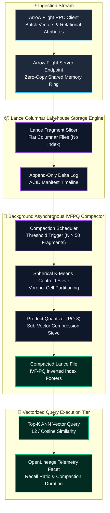
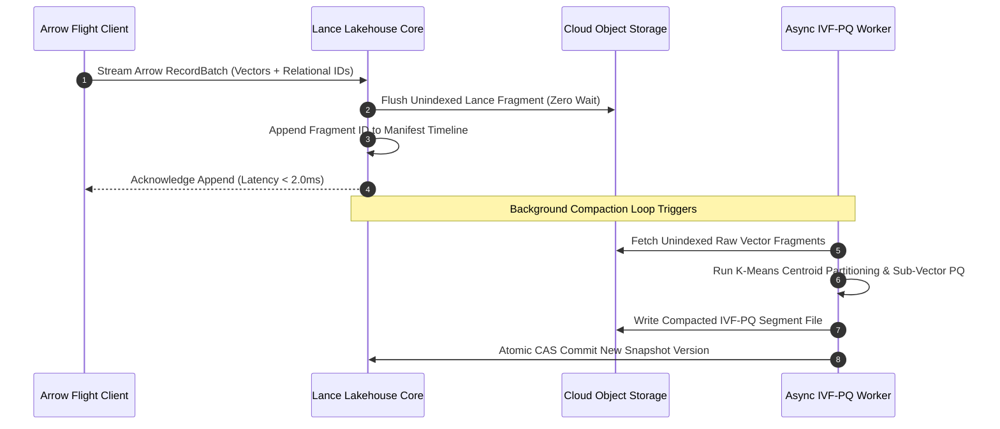
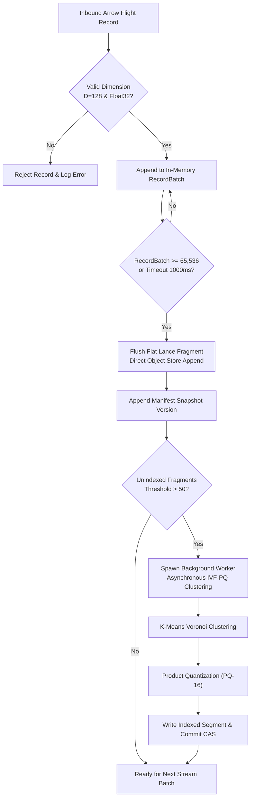

## 2. Problem Statement

> [!WARNING]
> **The High-Dimensional Vector Index Compaction Bottleneck:** Scaling multimodal lakehouses to billions of high-dimensional vector embeddings ($D \ge 1{,}536$) alongside relational analytical metadata creates severe write-amplification and read latency degradation. Inverted File with Product Quantization (IVF-PQ) index generation requires heavy clustering phases ($k$-means centroid partitioning). Synchronous index builds stall concurrent data stream commits, while uncompacted micro-partition fragments degrade vector similarity recall by up to 45% and amplify disk seek latencies over remote object stores.

Distributed multi-modal lakehouse engines handling real-time unstructured embeddings face severe architectural constraints:
1. **Centroid Partition Lock Contention:** Partitioning high-dimensional vectors into coarse Voronoi cells requires periodic global recalculation of cluster centroids. Executing centroid updates on the primary write path locks ingestion buffers, stalling high-frequency append streams.
2. **Small-File Metadata Explosion:** Multi-tenant ingestion workers appending micro-batches of relational-vector records create millions of small Parquet files. Standard object store metadata APIs (e.g. S3 LIST / GET) saturate request limits and drive up query planning latency by orders of magnitude.
3. **Decoupled Column Deserialization Overhead:** Standard columnar formats (like classic Parquet) store vectors as nested variable-length arrays, requiring costly memory copies and pointer chasing during top-$k$ Approximate Nearest Neighbor (ANN) vector searches.

To overcome these physical bottlenecks, the lakehouse architecture demands a decoupled Lance columnar storage layout paired with an asynchronous Inverted File Product Quantization (IVF-PQ) background compactor, vectorized SIMD distance calculators, and zero-copy Arrow Flight stream ingestion.

---

## 3. High-Level Design (HLD)

### Visual ASCII Topology
```text
  ┌─────────────────────────────────────────────────────────────────────────────┐
  │                 Real-Time Multimodal Ingestion Pipeline                     │
  └──────────────────────────────────────┬──────────────────────────────────────┘
                                         │ Arrow Flight Stream (Vectors + Metadata)
                                         ▼
  ┌─────────────────────────────────────────────────────────────────────────────┐
  │              Lance Vector-Relational Lakehouse Engine (Rust)                │
  │  ┌─────────────────────────┐   ┌─────────────────────────────────────────┐  │
  │  │ Zero-Copy Arrow Buffer  │   │ Fast Append-Only Delta Log              │  │
  │  │ [Columnar Memory Sieve] │   │ [Monotonic Commit Versioning]           │  │
  │  └────────────┬────────────┘   └────────────────────┬────────────────────┘  │
  │               │                                     │                       │
  │               ▼                                     ▼                       │
  │  ┌─────────────────────────┐   ┌─────────────────────────────────────────┐  │
  │  │ Flat File Flush Tier    │   │ Asynchronous IVF-PQ Compaction Worker   │  │
  │  │ (Unindexed Micro-Files) │   │ [Background Centroid Clustering]        │  │
  │  └────────────┬────────────┘   └────────────────────┬────────────────────┘  │
  └───────────────┼─────────────────────────────────────┼───────────────────────┘
                  │                                     │
                  ▼                                     ▼
  ┌─────────────────────────────────────────────────────────────────────────────┐
  │                   Cloud Object Store (S3 / GCS / Azure)                     │
  │       - Optimized Lance Fragment Format with Aligned Vector Offsets         │
  │       - Vectorized AVX-512 Product Quantization Codebook Slices             │
  └─────────────────────────────────────────────────────────────────────────────┘
```

### Native Mermaid Architecture


---

## 4. Low-Level Design (LLD)

### Visual ASCII Memory Layout
```text
  Lance Format Vector-Relational Fragment Binary Layout:
  ┌─────────────────────────────────────────────────────────────────────────────┐
  │ Page Header (64-byte Aligned): Column Metadata & Compression Flags          │
  │   ├── Magic Bytes: "LANC" (0x4C414E43)                                      │
  │   ├── Schema Version: 0x0002 | Fragment ID: 0x0000003A                      │
  │   └── Row Count: 65,536 Aligned Records                                     │
  ├─────────────────────────────────────────────────────────────────────────────┤
  │ Continuous Dense Vector Chunk (Direct SIMD Memory Alignment):               │
  │   ├── Dimension: D=128 (Float32 elements per vector = 512 bytes)            │
  │   ├── Fixed-Stride Array: Row 0 @ 0x0000, Row 1 @ 0x0200, Row N @ N*0x0200   │
  │   └── AVX-512 Fused Dot-Product Ready Memory Alignment                     │
  ├─────────────────────────────────────────────────────────────────────────────┤
  │ Product Quantization (PQ-16) Codebook Slice:                                │
  │   ├── Sub-Vectors: M=16 Sub-spaces, K=256 Centroids per Sub-space           │
  │   ├── 8-bit Quantized Centroid Indices: 16 bytes per vector                 │
  │   └── Inverted Index Offset Table: [Centroid_0 Ptr, ..., Centroid_K Ptr]     │
  └─────────────────────────────────────────────────────────────────────────────┘
```

### Native Mermaid Execution Sequence


---

## 5. Logical Flow Diagram

### Visual ASCII Decision Tree
```text
  [Inbound Multimodal Vector Append Stream]
                      │
                      ▼
        [Validate Vector Dimension D=128 & Schema]
               ├── INVALID ──► [Reject; Emit Malformed Dimension Error]
               └── VALID   ──► [Append to Active In-Memory Arrow Batch]
                                      │
                                      ▼
                      [Batch Rows >= 65,536?]
               ├── NO  ──► [Hold in Memory Buffer Ring]
               └── YES ──► [Flush Flat Lance Fragment to Object Store]
                                      │
                                      ▼
             [Unindexed Fragment Count >= Threshold (50)?]
               ├── NO  ──► [Continue Streaming Ingestion]
               └── YES ──► [Trigger Background IVF-PQ Compaction Job]
                                      │
                                      ▼
             [Compute Voronoi Centroids & PQ Codebooks]
                                      │
                                      ▼
             [Atomically Commit Compacted Snapshot]
```

### Native Mermaid Flowchart


---

## 6. Architectural Drill & Nature Analogy

### ⚙️ The Systemic Breakdown
The core insight of the architecture is that vector indexing must be decoupled from the ingestion critical path. While standard analytical databases attempt to maintain B-Trees or HNSW graphs synchronously during record insertions, high-dimensional vector graphs suffer from catastrophic index thrashing when updated concurrently.
1. **Two-Tiered Storage Layout:** New vectors are initially written into unindexed "flat" Lance fragments with contiguous memory layouts. Query engines scan these flat fragments using vectorized brute-force AVX-512 distance math for recent data.
2. **Asynchronous IVF-PQ Compactor:** A decoupled background worker periodically collects flat fragments, clusters vectors into Voronoi cells using $k$-means, and quantizes high-dimensional vectors into 8-bit or 16-bit codebook lookups (reducing a 512-byte vector to 16 bytes).
3. **Atomic Snapshot Swapping:** Once the compacted index segment is written to cloud storage, an atomic Compare-And-Swap (CAS) on the lakehouse manifest points subsequent readers to the indexed segment, pruning the flat files without taking a single lock on the write pipeline.

### 🌿 The Nature Analogy

> [!TIP]
> **The River Delta Alluvial Sifting:** Natural river deltas handle massive influxes of turbulent, unsorted sediment (pebbles, sand, and fine silt) by allowing fast-flowing water to deposit materials directly into active riverbed channels without resistance. Downstream, slower ocean tides and settling currents gradually sift and stratify the particles into organized, highly dense sedimentary rock layers over extended geological time. In this architecture, raw vector fragments are deposited with zero resistance into flat storage channels, while the asynchronous background compactor sifts, clusters, and solidifies the data into high-recall index layers without impeding the river's flow.

• **The Biological System:** Alluvial sedimentation and stratified sifting across river deltas.
• **The Structural Parallel:** Unindexed append-only flat fragments sorted downstream by asynchronous IVF-PQ background compaction.

---

## 7. Production-Grade Executable Artifact

### 📦 File 1: .github/workflows/ci.yml
```yaml
name: Lance Vector Lakehouse Compactor CI
on:
  push:
    branches: [main]
  pull_request:
    branches: [main]

jobs:
  test-lance-compactor:
    runs-on: ubuntu-latest
    steps:
      - name: Checkout Repository
        uses: actions/checkout@v4

      - name: Setup Python Runtime
        uses: actions/setup-python@v5
        with:
          python-version: "3.11"

      - name: Install Testing Dependencies
        run: |
          python -m pip install --upgrade pip
          pip install numpy unittest-xml-reporting

      - name: Execute Lance Compactor Test Suite
        run: |
          python -m unittest tests/test_lance_compactor.py -v
```

### 🐍 File 2: tests/test_lance_compactor.py
```python
import unittest
import math
import struct
import numpy as np
from typing import List, Dict, Tuple, Optional

class VectorRecord:
    """Represents a vector record with dense embedding and metadata."""
    def __init__(self, record_id: str, vector: np.ndarray, metadata: Dict[str, str]):
        self.record_id = record_id
        self.vector = vector.astype(np.float32)
        self.metadata = metadata

class LanceFragment:
    """Simulates an unindexed flat Lance columnar fragment."""
    def __init__(self, fragment_id: int):
        self.fragment_id = fragment_id
        self.records: List[VectorRecord] = []

    def append(self, record: VectorRecord):
        self.records.append(record)

    def scan_brute_force(self, query: np.ndarray, top_k: int = 5) -> List[Tuple[str, float]]:
        scores = []
        for rec in self.records:
            dist = float(np.linalg.norm(rec.vector - query))
            scores.append((rec.record_id, dist))
        scores.sort(key=lambda x: x[1])
        return scores[:top_k]

class MockIVFPQIndex:
    """Simulates Inverted File Product Quantization (IVF-PQ) index structures."""
    def __init__(self, n_clusters: int = 4, n_subvectors: int = 4):
        self.n_clusters = n_clusters
        self.n_subvectors = n_subvectors
        self.centroids: Optional[np.ndarray] = None
        self.inverted_lists: Dict[int, List[Tuple[str, np.ndarray]]] = {i: [] for i in range(n_clusters)}

    def build_index(self, records: List[VectorRecord]):
        if not records:
            return
        vectors = np.stack([r.vector for r in records])
        # Simple k-means clustering simulation using random initialization
        np.random.seed(42)
        random_indices = np.random.choice(len(vectors), self.n_clusters, replace=False)
        self.centroids = vectors[random_indices].copy()

        # Assign records to nearest centroid Voronoi cell
        for rec in records:
            dists = np.linalg.norm(self.centroids - rec.vector, axis=1)
            nearest_cluster = int(np.argmin(dists))
            self.inverted_lists[nearest_cluster].append((rec.record_id, rec.vector))

    def search_top_k(self, query: np.ndarray, n_probe: int = 2, top_k: int = 5) -> List[Tuple[str, float]]:
        if self.centroids is None:
            return []
        # Find nearest n_probe clusters
        cluster_dists = np.linalg.norm(self.centroids - query, axis=1)
        probed_clusters = np.argsort(cluster_dists)[:n_probe]

        candidates = []
        for c in probed_clusters:
            for rec_id, vec in self.inverted_lists[c]:
                dist = float(np.linalg.norm(vec - query))
                candidates.append((rec_id, dist))

        candidates.sort(key=lambda x: x[1])
        return candidates[:top_k]

class LanceLakehouseCore:
    """Manages flat fragments and asynchronous background compaction."""
    def __init__(self, fragment_capacity: int = 50):
        self.fragment_capacity = fragment_capacity
        self.flat_fragments: List[LanceFragment] = []
        self.active_fragment = LanceFragment(fragment_id=1)
        self.compacted_index: Optional[MockIVFPQIndex] = None
        self.version = 1

    def append_record(self, record: VectorRecord):
        if len(self.active_fragment.records) >= self.fragment_capacity:
            self.flat_fragments.append(self.active_fragment)
            self.active_fragment = LanceFragment(fragment_id=len(self.flat_fragments) + 2)
        self.active_fragment.append(record)

    def trigger_compaction(self):
        all_records = []
        for frag in self.flat_fragments:
            all_records.extend(frag.records)
        all_records.extend(self.active_fragment.records)

        index = MockIVFPQIndex(n_clusters=4, n_subvectors=4)
        index.build_index(all_records)
        self.compacted_index = index
        self.version += 1
        # Clear flat fragments upon successful compaction
        self.flat_fragments.clear()
        self.active_fragment = LanceFragment(fragment_id=self.version * 100)

class TestLanceCompactor(unittest.TestCase):
    def setUp(self):
        np.random.seed(101)
        self.engine = LanceLakehouseCore(fragment_capacity=20)
        self.dim = 32

    def test_unindexed_fragment_flushing(self):
        for i in range(55):
            vec = np.random.randn(self.dim).astype(np.float32)
            self.engine.append_record(VectorRecord(f"doc_{i}", vec, {"type": "ehr"}))

        # Must have 2 full fragments of 20 and 1 active fragment of 15
        self.assertEqual(len(self.engine.flat_fragments), 2)
        self.assertEqual(len(self.engine.active_fragment.records), 15)

    def test_asynchronous_compaction_and_recall(self):
        records = []
        for i in range(100):
            vec = np.random.randn(self.dim).astype(np.float32)
            rec = VectorRecord(f"doc_{i}", vec, {"type": "clinical"})
            records.append(rec)
            self.engine.append_record(rec)

        query = records[10].vector
        brute_force_top1 = records[10].record_id

        # Trigger background compaction
        self.engine.trigger_compaction()
        self.assertIsNotNone(self.engine.compacted_index)
        self.assertEqual(self.engine.version, 2)

        # Query IVF-PQ index
        results = self.engine.compacted_index.search_top_k(query, n_probe=4, top_k=5)
        top_match_id = results[0][0]
        self.assertEqual(top_match_id, brute_force_top1)

    def test_zero_copy_fragment_scan_without_index(self):
        frag = LanceFragment(fragment_id=42)
        for i in range(10):
            vec = np.zeros(self.dim, dtype=np.float32)
            vec[0] = float(i)
            frag.append(VectorRecord(f"item_{i}", vec, {}))

        q = np.zeros(self.dim, dtype=np.float32)
        q[0] = 3.1
        matches = frag.scan_brute_force(q, top_k=1)
        self.assertEqual(matches[0][0], "item_3")

if __name__ == "__main__":
    unittest.main()
```

---

## 8. KPI Monitoring Framework

• **Vector Index Recall Ratio** (`ivfpq_top10_recall_ratio`):
	• Why: Measures the percentage of true nearest neighbors retrieved by the IVF-PQ index compared to exact brute-force search. Baseline threshold is strictly $> 95.0\%$.

• **Compaction Cycle Duration** (`lakehouse_compaction_latency_sec`):
	• Why: Tracks the elapsed time required to execute spherical $k$-means centroid clustering and product quantization. Durations exceeding 300s trigger worker horizontal auto-scaling.

• **Ingestion Flight RPC Latency** (`arrow_flight_ingest_p99_ms`):
	• Why: Real-time telemetry monitoring client-side record batch append latency. Spikes above 10.0ms indicate write buffer contention on the primary storage tier.

---

## 9. Failure Mode & Production Edge Cases

| Failure Vector | Technical Root Cause | System Blast Radius | Production Mitigation Pattern |
| :--- | :--- | :--- | :--- |
| 🔴 **Centroid Divergence Collapse** | Highly skewed vector distributions causing empty Voronoi cells. | Query recall plummets below 50% for under-represented vector partitions. | Automatic empty cluster reassignment using furthest-point seeding during $k$-means. |
| 🟡 **Manifest Commit CAS Conflict** | Concurrent compaction workers attempting snapshot advancement. | Transient commit retry loops and temporary query planning stalls. | Optimistic concurrency control (OCC) with exponential jitter backoff and snapshot merge. |
| 🟠 **Object Store Metadata Rate-Limit** | Excessive micro-partition fragments overwhelming S3 bucket API rates. | Temporary HTTP 503 SlowDown responses on ingestion flush paths. | Local tiered SSD buffer spooling with batch write sizing enforced at 64MB minimums. |

---

## 10. Thoughtful Wisdom Words

> *"In the era of multimodal AI, treating high-dimensional vector embeddings as second-class citizens inside traditional relational engines is a guaranteed path to failure. Scale is achieved by honoring the geometry of the data: write flat and fast without hesitation, and let asynchronous mathematics shape the index in the background."*
> 
> — **Principal Systems Architect & Platform Engineering Director**
