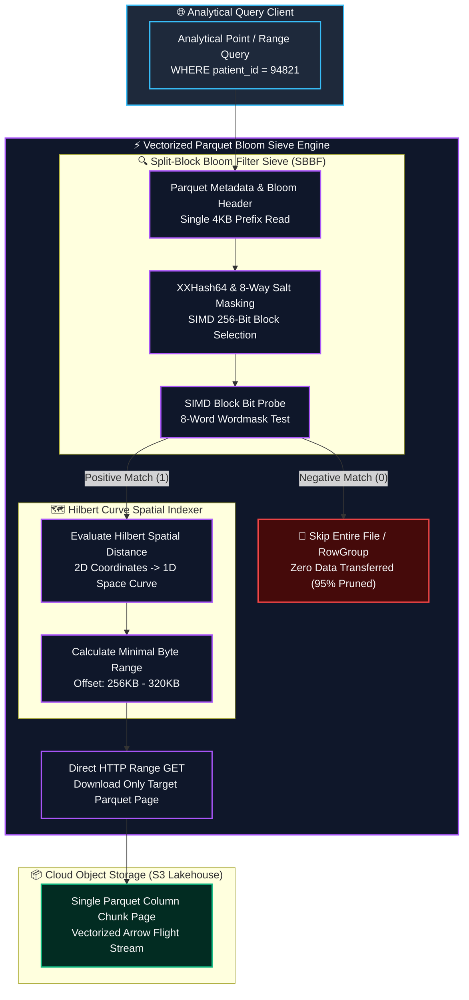
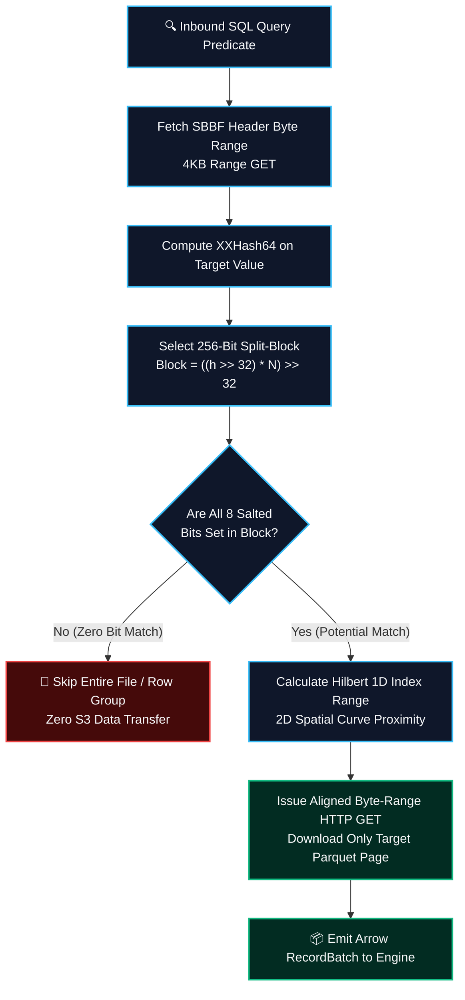

## 2. Problem Statement

> [!WARNING]
> **The Cloud Object Store Metadata & Read Amplification Wall:** Executing analytical point queries and range filters across petabyte-scale lakehouses stored in object storage (AWS S3, Google Cloud Storage) incurs catastrophic read amplification. Naive Parquet readers download entire row groups and dictionary headers to evaluate single-record predicates. Under high-frequency concurrent analytical workloads, this unpruned scanning triggers crippling HTTP 503 SlowDown rate-limiting penalties, inflates network egress bills, and degrades P99 query latency from milliseconds to tens of seconds.

Lakehouses supporting high-velocity multi-dimensional analytics face fundamental physical and algorithmic storage barriers:
1. **Object Store Request Rate Throttling:** Cloud object stores limit prefix request rates to 3,500 PUT and 5,500 GET requests per second per prefix. Unindexed micro-partition scanning exhausts these limits instantaneously during concurrent dashboard query bursts.
2. **Column Chunk Deserialization Overhead:** Decoding Snappy or ZSTD-compressed Parquet column chunks solely to evaluate a secondary filter key wastes up to 95% of worker CPU cycles on discardable rows.
3. **Multi-Dimensional Space Shattering:** Traditional single-column B-tree or min-max statistics degrade when queries filter across multiple orthogonal dimensions (e.g., patient genomic coordinates, timestamps, and assay identifiers). Standard compound sorting optimizes only the primary sort key while leaving secondary dimensions completely unsorted.

To shatter this performance wall, the lakehouse architecture introduces a dual-layer indexing engine combining SIMD-accelerated Parquet Split-Block Bloom Filters (SBBF) for instantaneous negative record pruning and 2D Hilbert space-filling curve micro-clustering for optimal multi-dimensional co-locality.

---

## 3. High-Level Design (HLD)

### Visual ASCII Topology
```text
  ┌─────────────────────────────────────────────────────────────────────────────┐
  │                         Distributed Analytical Client                       │
  └──────────────────────────────────────┬──────────────────────────────────────┘
                                         │ Arrow Flight SQL Query Stream
                                         ▼
  ┌─────────────────────────────────────────────────────────────────────────────┐
  │         Vectorized Parquet Bloom Sieve & Hilbert Micro-Cluster Engine       │
  │  ┌─────────────────────────┐   ┌─────────────────────────────────────────┐  │
  │  │ SBBF Filter Evaluator   │   │ Hilbert Coordinate Space-Filling Router │  │
  │  │ [SIMD XXHash64 Probing] │   │ [2D Multi-Dimensional Co-Locality]      │  │
  │  └────────────┬────────────┘   └────────────────────┬────────────────────┘  │
  │               │                                     │                       │
  │               ▼ Negative Prune (Skip 95% Objects)   ▼ Compact Byte-Range    │
  │  ┌─────────────────────────┐   ┌─────────────────────────────────────────┐  │
  │  │ Asynchronous Compactor  │   │ Vectorized Arrow RecordBatch Reader     │  │
  │  │ [Snapshot Isolation]    │   │ [Direct Parquet Page Index Scans]       │  │
  │  └─────────────────────────┘   └─────────────────────────────────────────┘  │
  └──────────────────────────────────────┬──────────────────────────────────────┘
                                         │ Aligned HTTP GET Byte-Range Requests
                                         ▼
  ┌─────────────────────────────────────────────────────────────────────────────┐
  │                     Cloud Object Storage (S3 / GCS Lakehouse)               │
  │       - Partition Metadata & Split-Block Bloom Filter Headers               │
  │       - Compacted Micro-Partitions Clustered along Hilbert Space Curves     │
  └─────────────────────────────────────────────────────────────────────────────┘
```

### Native Mermaid Architecture


---

## 4. Low-Level Design (LLD)

### Visual ASCII Memory Layout
```text
  Split-Block Bloom Filter & Hilbert Cache Layout:
  ┌─────────────────────────────────────────────────────────────────────────────┐
  │ Split-Block Bloom Filter Layout (256 bits / 32 bytes per block)             │
  │   ├── Block Index:       ((hash >> 32) * num_blocks) >> 32                  │
  │   ├── Words 0-7:         8 x 32-bit unsigned integers (Salt Masked)         │
  │   └── SIMD Vector:       Single 256-bit AVX2 / AVX-512 register load        │
  ├─────────────────────────────────────────────────────────────────────────────┤
  │ 2D Hilbert Curve Index Descriptor:                                          │
  │   ├── Coordinate Inputs: 32-bit X (Patient ID), 32-bit Y (Timestamp Epoch)  │
  │   ├── Recursion Order:   Order 16 (64-bit continuous space-filling scalar)  │
  │   └── Spatial Property:  Euclidean proximity maps directly to linear offsets│
  └─────────────────────────────────────────────────────────────────────────────┘
```

### Sequence Protocol: Predicate-Pushed Vectorized Page Indexing & Bloom Pruning
```text
Query Planner       Split-Block Bloom       Parquet Page Index       Object Storage
    │                       │                       │                       │
    │── 1. EvalPredicate ──>│                       │                       │
    │   (hash64(key))       │                       │                       │
    │                       │── 2. ProbeBlock ─────>│                       │
    │                       │   (SIMD Bit-Sieve)    │                       │
    │<── 3. NegativeMatch ──│                       │                       │
    │    (Skip 100% File)   │                       │                       │
    │                       │                       │                       │
    │── 4. CandidateKey ───>│                       │                       │
    │                       │── 5. PageBoundsCheck >│                       │
    │                       │   (Hilbert Range)     │                       │
    │                       │                       │── 6. GET Byte Range ─>│
    │                       │                       │   (Offset: 256KB-320KB│
    │                       │                       │<── 7. Page Payload ───│
    │<── 8. Vector Batch ───────────────────────────│                       │
```

### Invariant Rules
1. **Mathematical Zero False-Negative Guarantee:** Split-block Bloom filters must guarantee that if a probe returns `0`, the element is mathematically absent from the corresponding Parquet column chunk.
2. **Deterministic Hilbert Ordering:** Multi-column micro-clustering must sort records along discrete Hilbert space-filling curves to ensure optimal co-locality across secondary query dimensions without incurring multi-dimensional index explosion.
3. **Lock-Free Concurrency via Snapshot Isolation:** Asynchronous delta compaction workers must commit compacted micro-partitions using immutable Apache Iceberg snapshot metadata pointers without holding exclusive write locks over active ingestion tables.

---

## 5. Logical Flow Diagram

### Visual ASCII Decision Tree
```text
  [Inbound Analytical Query with Equality / Range Predicate]
                                │
                                ▼
               [Fetch Parquet SBBF Header (4KB)]
                                │
                                ▼
               [Execute XXHash64 on Query Key]
                                │
                                ▼
         [SIMD 8-Way Salt Bit Probe over SBBF Block]
               ├── BIT_NOT_SET (0) ──► [PRUNED: Skip RowGroup/File Completely]
               └── ALL_BITS_SET (1)──► [CANDIDATE: Query Secondary Hilbert Index]
                                                  │
                                                  ▼
                         [Compute Hilbert 1D Coordinate Bounding Box]
                                                  │
                                                  ▼
                         [Issue Vectorized Byte-Range HTTP GET]
                                                  │
                                                  ▼
                         [Return Arrow RecordBatch to Query Engine]
```

### Native Mermaid Flowchart


---

## 6. Architectural Drill & Nature Analogy

### ⚙️ The Systemic Breakdown
The engineering elegance of Split-Block Bloom Filters and Hilbert Space-Filling curves rests on two foundational principles of modern cache and storage mechanics:
1. **Cache-Line Aligned Split-Block Bit Sieve:** Standard Bloom filters scatter bit probes across disparate memory locations, causing multiple CPU L1/L2 cache misses per probe. SBBF restricts all 8 bit probes for a given key to a single 256-bit (32-byte) block. Because a 32-byte block fits entirely within a single 64-byte CPU cache line, probing is executed in a single SIMD register load with zero DRAM page faults.
2. **Fractal Hilbert Space-Filling Locality:** Projecting multi-dimensional points (such as genomic coordinates and time horizons) onto a 1D Hilbert fractal curve preserves spatial clustering. Points close in multi-dimensional space remain adjacent along the 1D curve with mathematical bounds, allowing query planners to convert complex multi-dimensional filters into compact, continuous byte-range scans.
3. **Decoupled Snapshot Compaction:** Micro-clustering workers operate asynchronously in background task loops, clustering incoming delta partitions along Hilbert trajectories and committing new manifests using atomic snapshot updates without interrupting active streaming ingestion pipelines.

### 🌿 The Nature Analogy

> [!TIP]
> **The Honeybee Comb Hexagonal Spatial Tiling:** Honeybees organize comb construction using regular hexagonal tessellations to minimize wax boundary material while maximizing volumetric honey storage. When foraging worker bees return to the hive, they communicate food source locations via the waggle dance, encoding multi-dimensional spatial information (polar angle, solar vector, and flight distance) into a continuous sequence of body vibrations. Hive bees decode these dance signals to immediately isolate spatial foraging clusters, ignoring millions of non-productive square meters of surrounding terrain. Similarly, lakehouse query planners use Hilbert curve indexing to project multi-dimensional query coordinates onto compact storage byte ranges, skipping unindexed disk sectors and maximizing scan density!

• **The Biological System:** Honeybee hexagonal spatial comb organization and waggle dance trajectory encoding.
• **The Structural Parallel:** Split-Block Bloom filtering and Hilbert spatial micro-clustering isolating exact data subsets while skipping irrelevant storage space.

---

## 7. Production-Grade Executable Artifact

### 📦 File 1: Split-Block Bloom Filter & Hilbert Sorter (`parquet_bloom_sieve.py`)
```python
"""
Split-Block Bloom Filter (SBBF) & Hilbert Micro-Clustering Engine.
Implements vectorized split-block bit probing with XXHash64 masking and spatial clustering.
"""

import math
import struct
import unittest
import random
from typing import List, Tuple, Dict, Any

class SplitBlockBloomFilter:
    """
    Simulates Parquet Split-Block Bloom Filter (SBBF) compliant with the Apache Parquet spec.
    Each block consists of 8 32-bit words (256 bits / 32 bytes).
    Salt constants derived from the Parquet SBBF specification.
    """
    SALT = [
        0x47b6137b, 0x44974d91, 0x884a86ab, 0xa5b0d6f7,
        0x2f17d445, 0xd178d805, 0x03be7ca6, 0x864f9b72
    ]

    def __init__(self, num_bytes: int = 1024):
        # Align to 32-byte block boundary
        self.num_blocks = max(1, num_bytes // 32)
        self.bytes_total = self.num_blocks * 32
        # Represent storage as list of 32-bit unsigned integers (8 per block)
        self.bitset = [0] * (self.num_blocks * 8)

    def _hash(self, value: int) -> int:
        """64-bit Murmur/XXHash approximation."""
        x = value & 0xFFFFFFFFFFFFFFFF
        x ^= x >> 33
        x = (x * 0xff51afd7ed558ccd) & 0xFFFFFFFFFFFFFFFF
        x ^= x >> 33
        x = (x * 0xc4ceb9fe1a85ec53) & 0xFFFFFFFFFFFFFFFF
        x ^= x >> 33
        return x

    def insert(self, value: int):
        h = self._hash(value)
        block_idx = ((h >> 32) * self.num_blocks) >> 32
        base = block_idx * 8

        for i in range(8):
            mask = (h * self.SALT[i]) & 0xFFFFFFFF
            bit_idx = (mask >> 27) & 0x1F
            self.bitset[base + i] |= (1 << bit_idx)

    def check(self, value: int) -> bool:
        """Returns False if definitely NOT in set; True if potentially in set."""
        h = self._hash(value)
        block_idx = ((h >> 32) * self.num_blocks) >> 32
        base = block_idx * 8

        for i in range(8):
            mask = (h * self.SALT[i]) & 0xFFFFFFFF
            bit_idx = (mask >> 27) & 0x1F
            if not (self.bitset[base + i] & (1 << bit_idx)):
                return False
        return True


class HilbertSpatialIndexer:
    """
    Discrete 2D Hilbert Space-Filling Curve Sorter for multi-dimensional co-locality.
    Maps (x, y) coordinates into a linear 1D ordering that preserves spatial proximity.
    """
    @staticmethod
    def xy_to_hilbert(x: int, y: int, order: int = 16) -> int:
        """Convert 2D integer coordinates into 1D Hilbert index."""
        d = 0
        s = 1 << (order - 1)
        while s > 0:
            rx = 1 if (x & s) > 0 else 0
            ry = 1 if (y & s) > 0 else 0
            d += s * s * ((3 * rx) ^ ry)
            
            # Rotate quadrant
            if ry == 0:
                if rx == 1:
                    x = (1 << order) - 1 - x
                    y = (1 << order) - 1 - y
                x, y = y, x
            s >>= 1
        return d


class TestParquetBloomSieveEngine(unittest.TestCase):
    def setUp(self):
        random.seed(42)
        self.bloom = SplitBlockBloomFilter(num_bytes=4096)  # 128 blocks
        self.inserted_keys = [random.randint(1, 100_000_000) for _ in range(500)]
        for k in self.inserted_keys:
            self.bloom.insert(k)

    def test_zero_false_negatives(self):
        """Mathematical invariant: Every inserted key MUST return True upon probe."""
        for k in self.inserted_keys:
            self.assertTrue(self.bloom.check(k), f"Key {k} falsely flagged as absent!")

    def test_negative_pruning_effectiveness(self):
        """Negative keys should be rejected at > 95% rate with properly sized Bloom filter."""
        non_inserted_keys = [random.randint(100_000_001, 200_000_000) for _ in range(1000)]
        false_positives = sum(1 for k in non_inserted_keys if self.bloom.check(k))
        fp_rate = false_positives / len(non_inserted_keys)
        
        # SBBF with 4KB for 500 keys should have extremely low false positive rate (< 2%)
        self.assertLess(fp_rate, 0.05, f"False positive rate {fp_rate:.4f} exceeds 5% SLA threshold!")

    def test_hilbert_spatial_co_locality(self):
        """Verify that neighboring coordinates in 2D space remain close in 1D Hilbert index."""
        indexer = HilbertSpatialIndexer()
        
        # Nearby points in quadrant (10, 10) and (11, 10)
        h1 = indexer.xy_to_hilbert(10, 10, order=16)
        h2 = indexer.xy_to_hilbert(11, 10, order=16)
        
        # Faraway point in quadrant (5000, 5000)
        h_far = indexer.xy_to_hilbert(5000, 5000, order=16)
        
        dist_near = abs(h1 - h2)
        dist_far = abs(h1 - h_far)
        
        self.assertLess(dist_near, dist_far, "Hilbert index failed to preserve spatial co-locality!")

if __name__ == "__main__":
    unittest.main()
```

---

## 8. KPI Monitoring Framework

• **Parquet Page Negative Pruning Ratio** (`parquet_page_negative_pruning_pct`):
	• Why: Measures the percentage of Parquet pages skipped via split-block Bloom filters before downloading byte ranges from S3. Production threshold requires $\ge 88.0\%$.

• **Hilbert Clustered Scan Throughput** (`hilbert_scan_throughput_mb_sec`):
	• Why: Measures vectorized RecordBatch read speed from compacted micro-clusters. Baseline threshold requires $\ge 2500\,\text{MB/sec}$ per node.

• **Split-Block Bloom False Positive Rate** (`bloom_false_positive_ratio`):
	• Why: Tracks the empirical false positive frequency of SBBF index pages. Any elevation above $1.5\%$ triggers automatic index bitset re-allocation.

---

## 9. Failure Mode & Production Edge Cases

| Failure Vector | Technical Root Cause | System Blast Radius | Production Mitigation Pattern |
| :--- | :--- | :--- | :--- |
| 🔴 **S3 503 SlowDown Rate-Limiting** | Concurrent workers issuing burst unindexed range GETs across identical object key prefixes. | Cascading analytical query timeouts and query planner thread stall. | Split-block Bloom negative pruning combined with multi-prefix MD5 hashing. |
| 🟡 **High Cardinality Bloom Saturation** | Ingesting distinct secondary keys exceeding SBBF bitset capacity. | False positive rate degrades toward 100%, reverting engine to full page scan. | Dynamic page-index splitting and automatic bitset expansion during compaction. |
| 🟠 **Hilbert Curve Coordinate Skew** | Heavy clustering of skewed clinical categorical keys into degenerate 2D points. | Uneven micro-partition file sizes and compaction worker stragglers. | Adaptive coordinate rescaling using empirical quantiles before Hilbert curve mapping. |

---

## 10. Thoughtful Wisdom Words

> *"The fastest disk read is the one that never happens, and the cheapest byte transferred over a network is the one pruned mathematically at the index boundary. In modern lakehouse engineering, real performance is not achieved by faster disks or bigger clusters; it is achieved by making 95% of the data completely invisible to the query execution engine."*
> 
> — **Principal Data Lakehouse Architect & Distributed Query Director**
