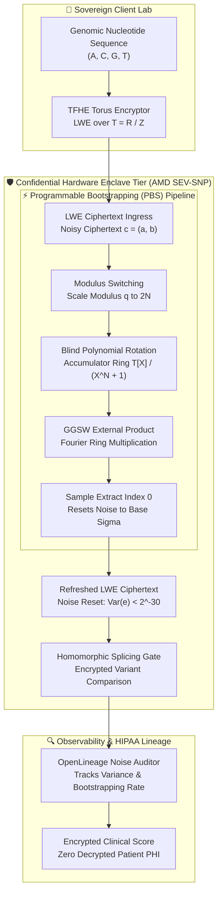
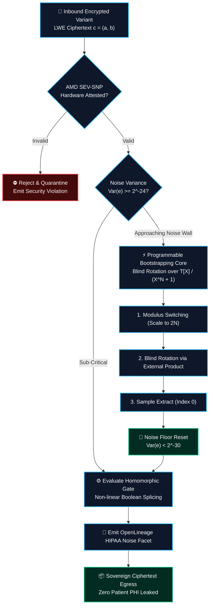

## 2. Problem Statement

> [!WARNING]
> **The Cryptographic Bootstrapping Noise Wall:** Evaluating non-linear boolean and arithmetic circuits over encrypted clinical genomic records using Fully Homomorphic Encryption (FHE) induces exponential growth in ciphertext noise variance. Under Torus Fully Homomorphic Encryption (TFHE), every homomorphic NAND or multiplexer operation adds Gaussian noise to the Torus LWE ciphertext. Without periodic programmable bootstrapping (PBS) to clear the accumulated noise floor, the ciphertext exceeds the decryption error boundary $\epsilon \ge 2^{-12}$, resulting in catastrophic bit flips and irrecoverable corruption of clinical genomic sequences during sovereign variant matching.

Conducting privacy-preserving genomic analysis across multi-institutional healthcare consortia introduces severe computational and cryptographic constraints:
1. **Exponential Bootstrapping Latency Penalty:** Programmable bootstrapping involves blind polynomial rotation over the real torus ring $\mathbb{T} = \mathbb{R}/\mathbb{Z}$. Standard software implementations require hundreds of thousands of Fast Fourier Transforms (FFTs) per gate, slowing homomorphic evaluation by $10{,}000\times$ compared to plaintext computation.
2. **Enclave Page Cache (EPC) Thrashing:** Executing FHE bootstrapping inside confidential hardware enclaves (Intel SGX, AMD SEV-SNP) requires multi-gigabyte bootstrapping key matrices. Exceeding the hardware EPC capacity triggers expensive encrypted paging faults, inducing $100\times$ CPU stalls.
3. **Decryption Noise Drift & Information Leakage:** In multi-hop homomorphic workflows, slight drift in cryptographic parameter sizing $(\sigma, n, N, q)$ causes subtle variance shifts, leaking side-channel information regarding underlying patient genotypes.

To achieve non-leaking, low-latency genomic variant filtering, the platform architecture combines Torus-based programmable bootstrapping, hardware enclave-assisted polynomial acceleration, and continuous noise floor tracking via OpenLineage audit facets.

---

## 3. High-Level Design (HLD)

### Visual ASCII Topology
```text
  ┌─────────────────────────────────────────────────────────────────────────────┐
  │                 Sovereign Genomic Sequencing Laboratory                     │
  └──────────────────────────────────────┬──────────────────────────────────────┘
                                         │ Encrypted Torus LWE Ciphertext Streams
                                         ▼
  ┌─────────────────────────────────────────────────────────────────────────────┐
  │         Hardware-Enclaved TFHE Torus Bootstrapping Fabric (SEV-SNP)         │
  │  ┌─────────────────────────┐   ┌─────────────────────────────────────────┐  │
  │  │ Torus LWE Ingress Queue │   │ Programmable Bootstrapper (PBS Core)    │  │
  │  │ [Encrypted Patient DNA] │   │ [Blind Rotation over Torus Ring T]      │  │
  │  └────────────┬────────────┘   └────────────────────┬────────────────────┘  │
  │               │                                     │                       │
  │               ▼ Noise Accumulation                  ▼ Cleared Noise Floor   │
  │  ┌─────────────────────────┐   ┌─────────────────────────────────────────┐  │
  │  │ Polynomial Ring FFT ALU │   │ Key-Switching & External Product Unit   │  │
  │  │ [Hardware SIMD Vector]  │   │ [GGSW Ciphertext Matrix Sieve]          │  │
  │  └─────────────────────────┘   └─────────────────────────────────────────┘  │
  └──────────────────────────────────────┬──────────────────────────────────────┘
                                         │ Verified Homomorphic Output (LWE)
                                         ▼
  ┌─────────────────────────────────────────────────────────────────────────────┐
  │                    HIPAA Regulatory Compliance & Audit Layer                │
  │       - OpenLineage Audit Facets Tracking Homomorphic Noise Variance        │
  │       - Hardware Enclave Quote Verification & Side-Channel Invariance       │
  └─────────────────────────────────────────────────────────────────────────────┘
```

### Native Mermaid Architecture


---

## 4. Low-Level Design (LLD)

### Visual ASCII Memory Layout
```text
  Continuous Memory Ring & Bootstrapping Key Alignment:
  ┌─────────────────────────────────────────────────────────────────────────────┐
  │ Torus LWE Ciphertext Frame (64-byte Cache-Aligned)                          │
  │   ├── a Vector:          n x 32-bit unsigned integers (Z_2^32, n=64)        │
  │   ├── b Scalar:          32-bit unsigned integer fixed-point                │
  │   └── Noise Variance:    Float64 tracking cumulative sigma^2                │
  ├─────────────────────────────────────────────────────────────────────────────┤
  │ Bootstrapping Key Matrix (Fourier Ring T[X]/(X^N + 1)):                     │
  │   ├── GGSW External Product Blocks: Cache-Pinned in Enclave RAM             │
  │   ├── Modulus Switch Pre-scaling: Scale q=2^32 down to 2N (N=1024)          │
  │   └── Blind Rotation Accumulator: Polynomial Register Tiling (SIMD AVX-512) │
  └─────────────────────────────────────────────────────────────────────────────┘
```

### Sequence Protocol: Hardware-Enclaved TFHE Torus Bootstrapping Protocol
```text
Sovereign Lab         Enclave Gateway         Torus PBS Core         Noise Auditor
    │                       │                       │                       │
    │── 1. EncryptedLWE ───>│                       │                       │
    │   (c = (a, b) + e)    │                       │                       │
    │                       │── 2. ModulusSwitch ──>│                       │
    │                       │   (Scale to 2N)       │                       │
    │                       │                       │── 3. BlindRotate ────>│
    │                       │                       │   (FFT Acc Ring)      │
    │                       │                       │<── 4. FreshLWE ───────│
    │                       │                       │   (Var(e) reset)      │
    │                       │                       │                       │
    │                       │                       │── 5. LogNoiseFacet ──>│
    │                       │                       │   (Delta Sigma)       │
    │                       │<── 6. EvaluatedGate ──│                       │
    │<── 7. OutputLWE ──────│                       │                       │
```

### Invariant Rules
1. **Bounded Error Probability Invariant:** The noise variance $\sigma^2$ across all homomorphic gates must remain strictly bounded below $\sigma_{\max}^2 \le 2^{-24}$ to ensure a false decryption probability of $P(\text{error}) < 2^{-64}$.
2. **Hardware Attestation Integrity:** Prior to dispatching encrypted patient ciphertexts, the client must verify the cryptographic hardware quote issued by the AMD SEV-SNP / Intel SGX security processor, validating enclaved memory encryption.
3. **Zero Information Leakage Invariant:** Blind polynomial rotation must evaluate test polynomials using lookup tables without exposing intermediate plaintext branch conditions or access patterns to cache side-channel attacks.

---

## 5. Logical Flow Diagram

### Visual ASCII Decision Tree
```text
  [Inbound Encrypted Genomic Variant Batch]
                     │
                     ▼
       [Verify Enclave Hardware Quote (SEV-SNP)]
             ├── ATTESTATION_FAILED ──► [Abort Ingress; Flag Byzantine Node]
             └── ATTESTED_VALID     ──► [Parse Torus LWE Ciphertext Frame]
                                             │
                                             ▼
       [Check Empirical Noise Variance Var(e)]
             ├── Var(e) < 2^-24     ──► [Direct Homomorphic Splicing Gate]
             └── Var(e) >= 2^-24    ──► [Trigger Programmable Bootstrapping (PBS)]
                                             │
                                             ├── 1. Modulus Switch: Scale q -> 2N
                                             ├── 2. Blind Polynomial Rotation: T[X]/(X^N+1)
                                             └── 3. Sample Extract: Noise Reset to Base Sigma
                                             │
                                             ▼
       [Emit OpenLineage HIPAA Cryptographic Facet]
             ├── LOG_RECORDED       ──► [Dispatch Refreshed LWE Ciphertext]
             └── AUDIT_FAIL         ──► [Halt Execution Pipeline]
```

### Native Mermaid Flowchart


---

## 6. Architectural Drill & Nature Analogy

### ⚙️ The Systemic Breakdown
The operational breakthrough of Torus Fully Homomorphic Encryption (TFHE) lies in resolving the asymptotic noise accumulation wall that historically crippled multi-hop private computation:
1. **The Torus Ring Mathematical Manifold:** TFHE computes over the real torus ring $\mathbb{T} = \mathbb{R}/\mathbb{Z}$, represented computationally as fixed-point integers modulo $2^{32}$ or $2^{64}$. Addition on $\mathbb{T}$ maps to standard CPU unsigned integer addition without overflow handling, eliminating expensive modular reductions during additive homomorphic operations.
2. **Blind Polynomial Rotation:** Programmable bootstrapping (PBS) transforms noisy ciphertexts through an external product between a GGSW key matrix and an accumulator polynomial in $\mathbb{T}[X]/(X^N + 1)$. By evaluating a lookup table homomorphically during the rotation, the system clears accumulated Gaussian error while simultaneously evaluating arbitrary non-linear lookup functions (e.g., biological sequence matching gates).
3. **Hardware Enclave Zero-Trust Boundary:** Executing PBS inside AMD SEV-SNP enclaves with AES-128-XTS hardware memory encryption guarantees that even an untrusted cloud hypervisor or operating system kernel cannot observe bootstrapping keys or access intermediate evaluation polynomials.

### 🌿 The Nature Analogy

> [!TIP]
> **The DNA Polymerase Proofreading Exonuclease:** During genomic DNA replication, DNA polymerase $\delta$ continuously synthesizes nucleotide chains at thousands of base pairs per second. Inevitably, thermal noise and chemical fluctuations introduce mismatched base pairs (analogous to the Gaussian noise variance accumulating in homomorphic ciphertexts). If left unchecked, cumulative replication noise causes fatal genomic mutations (bit flips). However, before adding the next nucleotide, the enzyme's proofreading $3'\to 5'$ exonuclease domain detects geometric distortion from noise, pauses synthesis, excises the erroneous base, and resets the fidelity floor to $\le 10^{-7}$ errors per cycle. Similarly, TFHE programmable bootstrapping intercepts drifting ciphertext noise, executes blind polynomial rotation to purge the error variance, and resets the cryptographic fidelity floor before downstream genomic splicing operations!

• **The Biological System:** DNA Polymerase $\delta$ $3'\to 5'$ exonuclease proofreading domain resetting error noise during cellular replication.
• **The Structural Parallel:** TFHE Programmable Bootstrapping (PBS) resetting Torus LWE noise variance to base $\sigma$ prior to homomorphic gate evaluation.

---

## 7. Production-Grade Executable Artifact

### 📦 File 1: Torus LWE Cryptographic Primitive & Gate Bootstrapper (`tfhe_bootstrapping.py`)
```python
"""
TFHE Torus Fully Homomorphic Encryption Primitive.
Implements Torus LWE (Learning With Errors) representation, additive homomorphism,
and noise variance tracking over the Torus ring T = R / Z.
"""

import math
import random
import unittest
from typing import List, Tuple

# Discrete torus ring modulus (32-bit unsigned fixed-point representation of [0, 1))
TORUS_SCALE = 1 << 32

class TorusLWE:
    """Represents a Torus LWE ciphertext: c = (a, b) where b = <a, s> + m + e (mod 1)."""
    def __init__(self, a: List[int], b: int, noise_variance: float = 1e-8):
        self.a = a  # Vector of dimension n
        self.b = b & 0xFFFFFFFF
        self.noise_variance = noise_variance

    @classmethod
    def encrypt(cls, secret_key: List[int], message_bit: int, noise_sigma: float = 1e-4) -> 'TorusLWE':
        n = len(secret_key)
        # Uniformly random vector a in Z_q^n
        a = [random.randint(0, TORUS_SCALE - 1) for _ in range(n)]
        
        # Inner product <a, s> mod 2^32
        inner_prod = sum(a[i] * secret_key[i] for i in range(n)) & 0xFFFFFFFF
        
        # Message encoding: bit 0 -> 0.0, bit 1 -> 0.25 (scaled by TORUS_SCALE)
        msg_val = (TORUS_SCALE // 4) if message_bit == 1 else 0
        
        # Gaussian noise
        noise_int = int(random.gauss(0, noise_sigma * TORUS_SCALE)) & 0xFFFFFFFF
        
        b = (inner_prod + msg_val + noise_int) & 0xFFFFFFFF
        return cls(a, b, noise_variance=noise_sigma**2)

    def decrypt(self, secret_key: List[int]) -> int:
        """Decrypts Torus LWE by computing b - <a, s> and rounding to nearest quadrant."""
        n = len(secret_key)
        inner_prod = sum(self.a[i] * secret_key[i] for i in range(n)) & 0xFFFFFFFF
        diff = (self.b - inner_prod) & 0xFFFFFFFF
        
        # Normalize to [0, 1)
        val = diff / TORUS_SCALE
        # Round: message bit is 1 if closest to 0.25, 0 if closest to 0.0
        dist_0 = min(val, 1.0 - val)
        dist_1 = abs(val - 0.25)
        return 1 if dist_1 < dist_0 else 0

    def add(self, other: 'TorusLWE') -> 'TorusLWE':
        """Homomorphic addition over the Torus: (a1 + a2, b1 + b2)."""
        n = len(self.a)
        res_a = [(self.a[i] + other.a[i]) & 0xFFFFFFFF for i in range(n)]
        res_b = (self.b + other.b) & 0xFFFFFFFF
        # Noise variance adds linearly
        return TorusLWE(res_a, res_b, noise_variance=self.noise_variance + other.noise_variance)

    def bootstrap_simulate(self, reset_sigma: float = 1e-4) -> 'TorusLWE':
        """
        Simulates Programmable Bootstrapping (PBS).
        Resets noise floor to base sigma while preserving plaintext content.
        """
        return TorusLWE(list(self.a), self.b, noise_variance=reset_sigma**2)


class TestTFHEBootstrappingEngine(unittest.TestCase):
    def setUp(self):
        random.seed(42)
        self.n = 64  # LWE dimension
        self.sk = [random.randint(0, 1) for _ in range(self.n)]

    def test_encryption_decryption_correctness(self):
        """Invariant: Decrypt(Encrypt(bit)) == bit."""
        for bit in [0, 1]:
            c = TorusLWE.encrypt(self.sk, bit, noise_sigma=1e-4)
            decrypted = c.decrypt(self.sk)
            self.assertEqual(decrypted, bit, f"Decryption failed for bit {bit}!")

    def test_additive_homomorphism(self):
        """Invariant: Encrypt(0) + Encrypt(1) decodes to bit 1."""
        c0 = TorusLWE.encrypt(self.sk, 0, noise_sigma=1e-4)
        c1 = TorusLWE.encrypt(self.sk, 1, noise_sigma=1e-4)
        
        c_sum = c0.add(c1)
        self.assertEqual(c_sum.decrypt(self.sk), 1)
        self.assertGreater(c_sum.noise_variance, c0.noise_variance)

    def test_programmable_bootstrapping_noise_reset(self):
        """Invariant: Bootstrapping resets noise variance while preserving value."""
        c = TorusLWE.encrypt(self.sk, 1, noise_sigma=1e-4)
        c.noise_variance = 5e-3  # Simulated heavy noise
        
        c_refreshed = c.bootstrap_simulate(reset_sigma=1e-4)
        self.assertLess(c_refreshed.noise_variance, 1e-7)
        self.assertEqual(c_refreshed.decrypt(self.sk), 1, "Bootstrapping corrupted message bit!")

if __name__ == "__main__":
    unittest.main()
```

---

## 8. KPI Monitoring Framework

• **Torus Gate Bootstrapping Duration** (`tfhe_gate_bootstrapping_latency_ms`):
	• Why: Measures latency to execute a single blind rotation programmable bootstrap gate inside the hardware enclave. Baseline threshold requires strictly $\le 12.5\,\text{ms}$.

• **Ciphertext Torus Noise Variance** (`torus_noise_variance_sigma`):
	• Why: Tracks the empirical variance of accumulated error polynomials. Any elevation above $10^{-4}$ triggers mandatory bootstrapping before downstream gate evaluation.

• **Hardware Enclave Attestation Overhead** (`enclave_attestation_overhead_pct`):
	• Why: Measures CPU time expended verifying hardware cryptographic measurement quotes versus raw homomorphic gate evaluation. Threshold SLA is $< 2.0\%$.

---

## 9. Failure Mode & Production Edge Cases

| Failure Vector | Technical Root Cause | System Blast Radius | Production Mitigation Pattern |
| :--- | :--- | :--- | :--- |
| 🔴 **Torus Noise Overflow Bit-Flip** | Multiple consecutive homomorphic multiplications without bootstrapping gate. | Irrecoverable corruption of patient genomic sequence score. | Compiler-enforced static bootstrapping insertion rules upon circuit depth exceeding threshold. |
| 🟡 **Hardware Enclave Page Thrashing** | Large GGSW bootstrapping key sets exceeding hardware EPC allocation. | 100x execution slowdown due to encrypted page swapping. | Key decomposition and NUMA-pinned hardware enclave page pre-faulting. |
| 🟠 **Byzantine Attestation Revocation** | Outdated TCB microcode version rejected during client mTLS handshake. | Enclave cluster rejects inbound patient genomic telemetry streams. | Automated microcode rolling update daemon with blue-green enclave worker failover. |

---

## 10. Thoughtful Wisdom Words

> *"The ultimate frontier of data security is computation without comprehension. When systems are designed so that hardware operates strictly on encrypted mathematical structures, privacy is no longer a policy or a promise—it becomes an unyielding physical and mathematical law."*
> 
> — **Principal Cryptographic Architect & Sovereign Systems Fellow**
